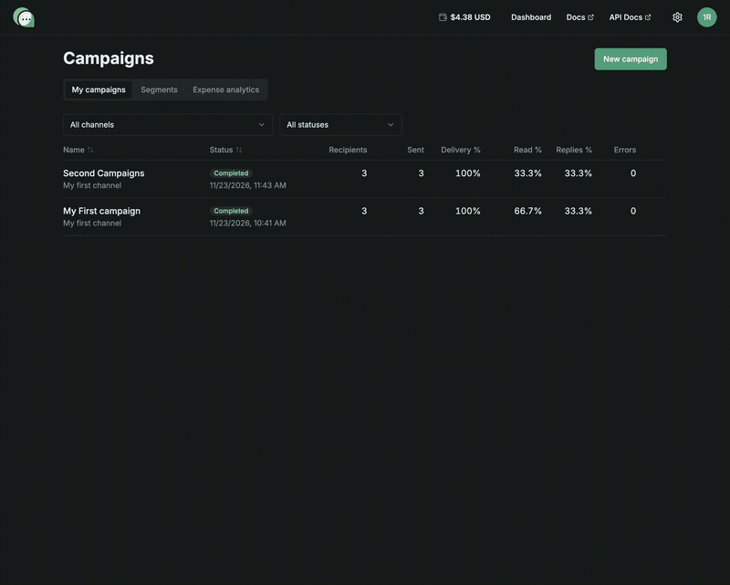
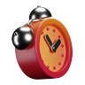

A campaign takes one WhatsApp message and sends it at once to every recipient you chose, from a connected channel. You decide who receives it, which text goes out, and when. After it starts, the same screen shows how many messages were sent and delivered, and what it cost.

> [!NOTE]
> **For developers.** Integrate Campaigns into your own system through the [Campaigns API](/docs/reference/campaigns). Every capability and the way it works are the same as described below for the interface.

> [!NOTE]
> **What you need to start**
>
> 1. The WhatsApp channel must be connected. How to do that is described in [Connect WABA](/docs/whatsapp/connect-waba).
> 2. A marketing or utility campaign needs an [approved template](/docs/reference/whatsapp/add-template). Plain text can be sent only inside an open [24-hour window](/docs/whatsapp/24-hour-window). You can create the template on the [connected channel page](https://platform.1msg.io/channels) in the interface or with the API method [addTemplate](/docs/reference/whatsapp/add-template).

## Quick start

1. **Create a segment.** Open **Campaigns → Segments → [New segment](https://platform.1msg.io/messaging/campaigns/segments/new)**. Add recipients by hand, from a CSV, or by a condition from Inbox, and set the attributes you want inserted into the message.

   More: [Create a segment](./segment.md).

2. **Create the campaign.** To create one, open [Campaigns](https://platform.1msg.io/messaging/campaigns) and click **New campaign**. Choose the channel and the segment, and fill in the template or the text. Check the preview, send a test, then send now or schedule it.

   More: [Create a campaign](./create.md).

3. **View the statistics.** Open the campaign. The overview shows delivery and the actual cost. The Recipients, Replies, and Errors tabs show the detail.

   More: [Campaign analytics](./analytics.md).

## Capabilities

### Segment

| | |
| --- | --- |
|  | **An audience in a couple of minutes** Add recipients by hand, upload a CSV, or collect them straight from Inbox, for example every dialog of one teammate. |
|  | **An audience that builds itself** A dynamic segment picks recipients by Inbox rules: open dialogs, the 24-hour window, the assignee, the last message. You no longer export and clean lists by hand. |
|  | **Stoplist** Recipients who unsubscribe land there automatically: marketing messages are not sent to them, and you do not pay for those messages. Utility and Auth follow the setting. You can set your own stop words. Settings, lists, and stop words are managed in the channel information section → Settings. |

### Sending

| | |
| --- | --- |
|  | **Preview** See the message as the recipient will, before it is sent. |
|  | **Test send** Send one copy to your phone and check the text for real. |
|  | **Send now or on a schedule** Pick a time, and the campaign goes out on its own. |
|  | **A message that sounds personal** Upload the data and set personal attributes. You can do this for any channel. “Anna, your order `#1234` is already `on the way`, and your discount is `15%`.” Any data is filled into the template on its own, and no recipient receives a message with a blank spot. |
|  | **Your own daily limit** The campaign splits itself into portions and stays within your number’s tier. |
|  | **Message lifetime** The offer is only for today? Set how long the message stays relevant. If Meta does not deliver it in that time, the recipient does not receive it and does not see an outdated offer tomorrow. |
|  | **Full control of the launch** A campaign that is already sending can be paused and resumed. A scheduled one can go back to draft so you can edit it. |

### Analytics

| | |
| --- | --- |
|  | **Cost without surprises** You see the cost forecast before sending, and you pay only for delivered messages. |
|  | **The result on one screen** How many were sent, delivered, and read, and how many replies and errors there were. |
|  | **Detailed analytics** You see not only the overall statistics, but the detail for each recipient. When the message was delivered and when it was read. Who replied, and when. Every reply: a button tap and free text. The list of recipients the message did not reach, and which error. |
|  | **Retry for undelivered** In one step, create a new campaign only from the recipients the message did not reach. |
|  | **Expense report** Gather spend by channel, period, or the campaigns you select. |

## FAQ

Do I need an approved template?

Yes, if the campaign is marketing or utility: that message goes out only with an approved template. Plain text without a template can be sent only inside an open 24-hour window.

How many recipients can I add to a segment?

The limit is 500 for now. Email <a href="mailto:hello@1msg.io">hello@1msg.io</a>, and we will raise it on request.

How many messages can I send per day?

That depends on the limit Meta sets for the number. The limit counts how many unique recipients you can message first in a rolling 24 hours: 250, 1,000, 10,000, 100,000, or unlimited. A new number usually starts at 250 or 1,000. Replies in an open dialog do not count toward the limit.

How do I raise the limit?

Meta raises it automatically when the number is actively messaging and its quality is good, meaning recipients do not block messages or complain. Usually that means messaging about half of the current limit within 7 days. The current limit and the quality rating are visible in Meta Business Manager.

What happens if the campaign is larger than the limit?

Messages over the limit will not go out, and Meta returns an error. To avoid that, set a daily limit on the Schedule step: the campaign splits across days. For example, with a limit of 1,000 and a segment of 3,500 recipients, sending takes 4 days.

Why did some recipients not get the message?

Most often it is one of three reasons. Meta limits how many marketing messages one person receives in a period if they do not open them (error 131049). The recipient unsubscribed or is on the stoplist. Or the number is not registered on WhatsApp. The reason is on the Errors tab.

Does a campaign affect the number’s quality?

Yes. If many recipients block messages or complain, the quality rating drops, and Meta may lower the limit or pause the template. Write to people who gave consent, and do not send the same thing too often.

When is the cost visible?

The forecast is shown on the Review step, and the actual amount appears in analytics after sending.

Do I need the recipient’s consent?

Yes. Meta requires it, especially for marketing messages. The platform does not store or check consent.

Can I see who did not receive the message?

Yes. Open the campaign and go to the Errors tab: it lists the recipients the message was not delivered to, with the code and the description of the error from Meta. People who were skipped (unsubscribed and those on the stoplist) are on the Skipped tab. To send to them again, create a new campaign only for the undelivered.

Can I export who replied to the campaign and what they said?

The Replies tab shows each recipient who replied, their reply (as text or a button tap), and the time. Export to a file. Through the API you can get this data with <a href="/docs/reference/campaigns/reply-feed">Replies</a> and <a href="/docs/reference/campaigns/recipient-analytics">Recipients</a>.

