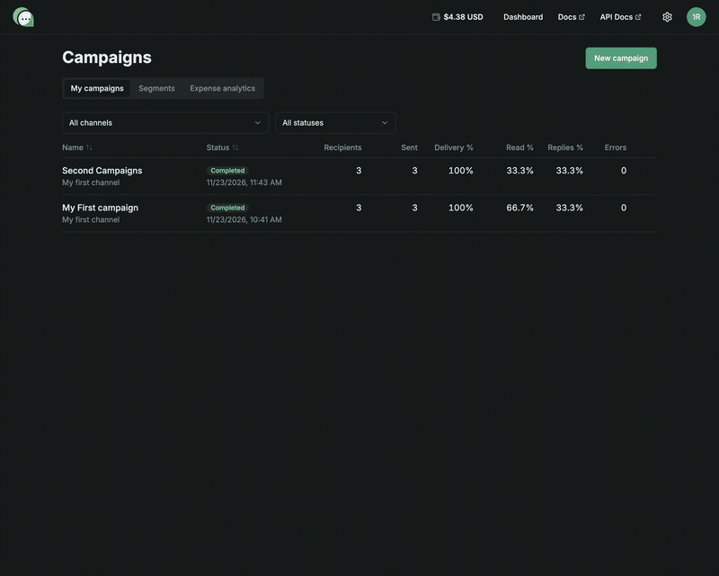

Рассылка берёт одно сообщение WhatsApp и отправляет его сразу всем выбранным получателям с подключённого канала. Вы задаёте, кому писать, какой текст отправить и в какое время. После старта на этом же экране видно, сколько сообщений отправлено и доставлено и сколько это стоило.

> [!NOTE]
> **Для разработчиков.** Интегрируйте Campaigns в свою систему через [Campaigns API](/ru/docs/reference/campaigns). Все возможности и условия работы такие же, как описано ниже для версии интерфейса.

> [!NOTE]
> **Что нужно для старта**
>
> 1. Канал WhatsApp должен быть подключён. Как это сделать, описано в разделе [Подключение WABA](/ru/docs/whatsapp/connect-waba).
> 2. Для маркетинговой или служебной рассылки нужен [одобренный шаблон](/ru/docs/reference/whatsapp/add-template). Обычный текст можно отправить только в открытом [окне 24 часа](/ru/docs/whatsapp/24-hour-window). Шаблон можно создать на [странице подключённого канала](https://platform.1msg.io/channels) через интерфейс или методом API [addTemplate](/ru/docs/reference/whatsapp/add-template).

## Быстрый старт

1. **Создайте сегмент.** Откройте **Campaigns → Segments → [New segment](https://platform.1msg.io/messaging/campaigns/segments/new)**. Добавьте получателей вручную, из CSV или по условию из Inbox и укажите атрибуты, которые хотите подставлять в сообщение.

   Подробнее: [Создание сегмента](./segment.ru.md).

2. **Создайте рассылку.** Чтобы создать, перейдите в [Campaigns](https://platform.1msg.io/messaging/campaigns) и нажмите **New campaign**. Выберите канал и сегмент, заполните шаблон или текст. Проверьте превью, сделайте тестовую отправку, затем отправьте сразу или запланируйте.

   Подробнее: [Создание рассылки](./create.ru.md).

3. **Посмотрите статистику.** Откройте рассылку. Общий экран показывает доставку и фактическую стоимость, а вкладки «Получатели», «Ответы» и «Ошибки» дают детали.

   Подробнее: [Аналитика рассылки](./analytics.ru.md).

## Возможности

### Сегмент

| | |
| --- | --- |
|  | **Любая аудитория за пару минут** Добавьте получателей вручную, загрузите список из CSV или соберите прямо из Inbox, например все диалоги одного сотрудника. |
|  | **Аудитория, которая собирается сама** Динамический сегмент подбирает получателей по правилам Inbox: открытые диалоги, окно 24 часа, исполнитель, последнее сообщение. Списки больше не нужно выгружать и чистить вручную. |
|  | **Стоп-лист** Отписавшиеся попадают туда автоматически: маркетинговые сообщения им не уходят, и платить за них не нужно. Utility и Auth учитываются по настройке. Можно задать свои стоп-слова. Настройки, списки и стоп-слова меняются в разделе информации о канале → Настройки. |

### Отправка

| | |
| --- | --- |
|  | **Превью** Посмотрите на сообщение глазами получателя ещё до отправки. |
|  | **Тестовая отправка** Пришлите одну копию себе на телефон и проверьте текст вживую. |
|  | **Отправка сразу или по расписанию** Выберите время, и рассылка уйдёт сама. |
|  | **Сообщение, будто написанное лично** Загрузите данные и укажите персональные атрибуты. Так можно для любого канала. «Анна, ваш заказ `№1234` уже `в пути`, а для вас скидка `15%`». Любые данные подставляются в шаблон сами, и ни один получатель не получит сообщение с пустым местом. |
|  | **Свой дневной лимит** Рассылка сама разобьётся на порции и не выйдет за тир вашего номера. |
|  | **Время жизни сообщения** Акция действует только сегодня? Задайте, сколько времени сообщение остаётся актуальным. Если Meta не успеет доставить его за этот срок, получатель его не получит и не увидит устаревшее предложение завтра. |
|  | **Полный контроль над запуском** Идущую рассылку можно поставить на паузу и продолжить, а запланированную вернуть в черновик и поправить. |

### Аналитика

| | |
| --- | --- |
|  | **Стоимость без сюрпризов** Прогноз расходов виден до отправки, а платите вы только за доставленные сообщения. |
|  | **Результат на одном экране** Сколько отправлено, доставлено, прочитано, сколько ответов и ошибок. |
|  | **Подробная аналитика** Вы видите не только общую статистику, а детали по каждому получателю. Когда сообщение доставлено и когда прочитано. Кто ответил и когда. Все ответы: и нажатие кнопки, и свободный текст. Список получателей, которым сообщение не пришло, и какая ошибка. |
|  | **Повтор для недоставленных** Одним действием создайте новую рассылку только из получателей, которым сообщение не дошло. |
|  | **Отчёт о расходах** Соберите траты по каналу, периоду или выбранным рассылкам. |

## Частые вопросы

Нужен ли одобренный шаблон?

Да, если рассылка маркетинговая или служебная: такое сообщение уходит только одобренным шаблоном. Обычный текст без шаблона можно отправить только в открытом окне 24 часа.

Сколько получателей можно добавить в сегмент?

Сейчас лимит временно 500. Напишите письмо на <a href="mailto:hello@1msg.io">hello@1msg.io</a>, и мы увеличим его по запросу.

Сколько сообщений можно отправить в сутки?

Это зависит от лимита номера, который задаёт Meta. Лимит считает, скольким уникальным получателям можно написать первым за скользящие 24 часа: 250, 1 000, 10 000, 100 000 или без ограничений. Новый номер обычно начинает с 250 или 1 000. Ответы в открытом диалоге в лимит не входят.

Как повысить лимит?

Meta повышает его автоматически, если номер активно пишет и у него хорошее качество, то есть получатели не блокируют сообщения и не жалуются. Обычно для этого за 7 дней нужно написать примерно половине текущего лимита. Текущий лимит и рейтинг качества видны в Meta Business Manager.

Что будет, если рассылка больше лимита?

Сообщения сверх лимита не уйдут, и Meta вернёт ошибку. Чтобы этого не случилось, на шаге Schedule задайте дневной лимит: рассылка разделится на части по дням. Например, при лимите 1 000 и сегменте 3 500 получателей отправка займёт 4 дня.

Почему часть получателей не получила сообщение?

Чаще всего причина в одном из трёх. Meta ограничивает число маркетинговых сообщений одному человеку за период, если он их не открывает (ошибка 131049). Получатель отписался или попал в стоп-лист. Или номер не зарегистрирован в WhatsApp. Причина видна во вкладке Errors.

Влияет ли рассылка на качество номера?

Да. Если много получателей блокируют сообщения или жалуются, рейтинг качества падает, и Meta может снизить лимит или приостановить шаблон. Пишите тем, кто дал согласие, и не отправляйте одно и то же слишком часто.

Когда видна стоимость?

Прогноз показывается на шаге Review, а фактическая сумма появляется в аналитике после отправки.

Нужно ли согласие получателя?

Да, этого требует Meta, особенно для маркетинговых сообщений. Платформа согласие не хранит и не проверяет.

Можно ли посмотреть, кто не получил сообщение?

Да. Откройте рассылку и перейдите на вкладку Errors: там список получателей, которым сообщение не доставили, с кодом и описанием ошибки от Meta. Тех, кого пропустили (отписавшихся и тех, кто в стоп-листе), можно найти на вкладке Skipped. Если нужно отправить им ещё раз, создайте новую рассылку только на недоставленных.

Можно ли выгрузить, кто ответил на рассылку и что именно?

На вкладке Replies видно каждого ответившего получателя, его ответ (текстом или нажатием кнопки) и время. Выгрузка в файл. Через API эти данные можно забрать методами <a href="/ru/docs/reference/campaigns/reply-feed">Ответы</a> и <a href="/ru/docs/reference/campaigns/recipient-analytics">Получатели</a>.

