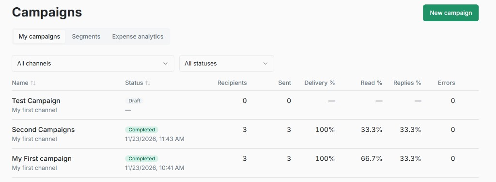
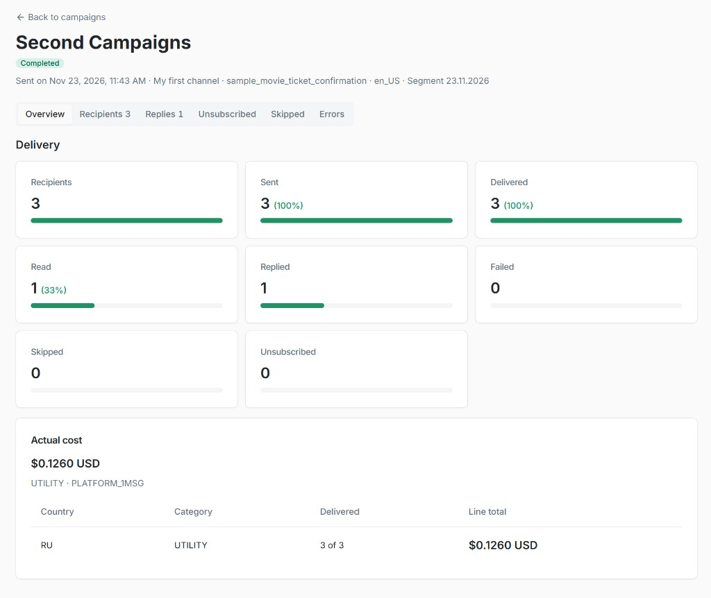
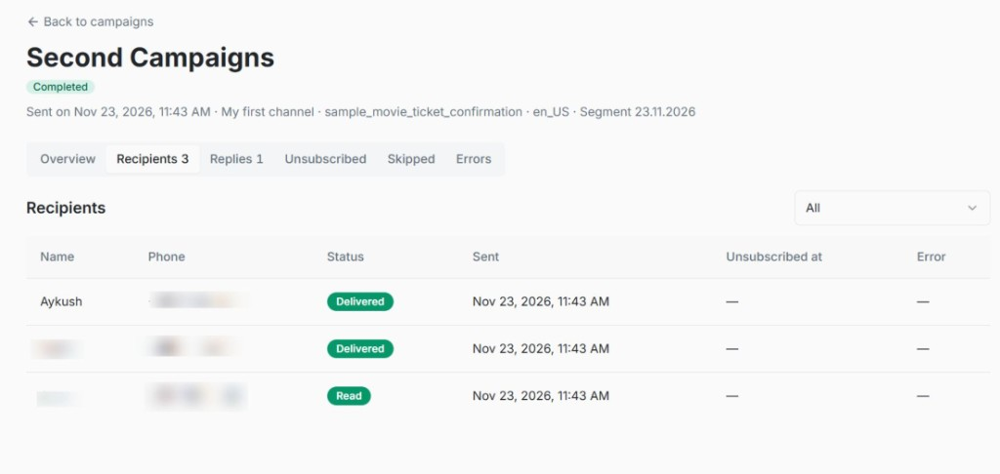
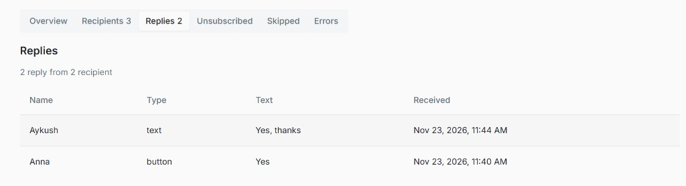
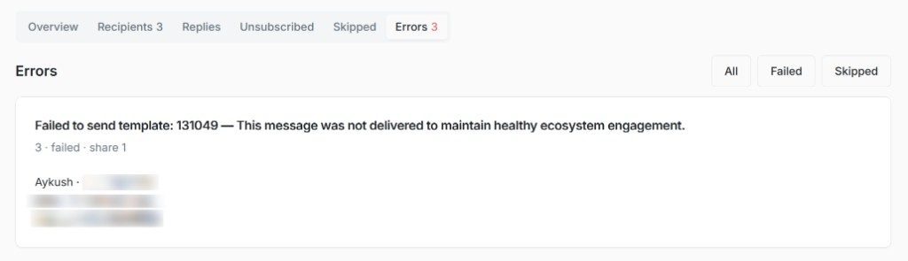

The same numbers are already in the campaign list, before you open a campaign. The row shows **Recipients**, **Sent**, **Delivery %**, **Read %**, **Replies %**, and **Errors**. A draft has a dash instead of percentages. A finished campaign, for example, went to three people, delivery 100%, read 33.3%, replies 33.3%, errors 0.

Open a sent campaign in [Campaigns](https://platform.1msg.io/messaging/campaigns).

In the campaign details, right under the title, you see the status badge, the send time, the channel, the template, the language, and the segment.

## Overview

The **Delivery** cards build the funnel. Each one shows a count and its share of all recipients.

- **Recipients** — how many people were in this send
- **Sent** — how many messages went out
- **Delivered** — how many reached the phone
- **Read** — how many were read
- **Replied** — how many replied
- **Failed** — how many were not sent
- **Skipped** — how many the campaign skipped
- **Unsubscribed** — how many unsubscribed

The bars next to the numbers show the same thing at a glance. For example, the message went to three people and reached three, and one person read it.

**Actual cost** is no longer the forecast from the review step. It is the amount that was charged. Below is the breakdown: country, template category, how many of how many were delivered, and the line amount. On the screen it looks like this: country RU, category UTILITY, delivered 3 of 3.

## Recipients

The **Recipients** tab is a list of people, not one total. Each row has a name, a phone, a status, the time in **Sent**, the unsubscribe time in **Unsubscribed at**, and the text in **Error** when there is one. A status can be **Delivered** or **Read**: the message arrived, and for someone it was also opened. The filter on the right defaults to **All**.

## Replies

The **Replies** tab shows who replied and with what. The **Type** column is **text** when the person wrote a message, and **button** when they tapped a button. Next to that are the reply text and the time in **Received**. For example, one recipient wrote “Yes, thanks”, and Anna tapped “Yes”. At the top you see how many replies there are and from how many people.

## Errors

The **Errors** tab collects the reasons a message did not go out. The text comes from Meta, together with a code, and under it are the people that reason applied to. The **All**, **Failed**, and **Skipped** filters separate send errors from skips.

For example, Meta may write that the message was not delivered in order to maintain healthy engagement, code 131049. The wording is on the screen, so you do not need to look it up separately.

## Unsubscribed and Skipped

The **Unsubscribed** and **Skipped** tabs collect people who unsubscribed and people the campaign skipped. The same numbers are already shown as cards on **Overview**.
