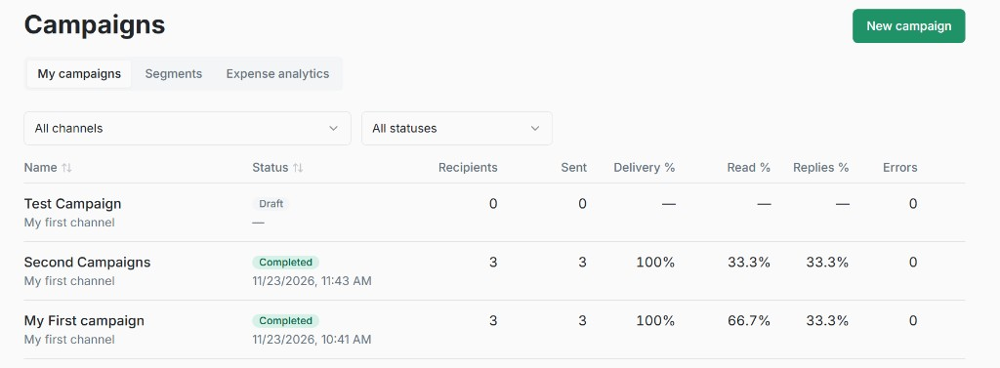
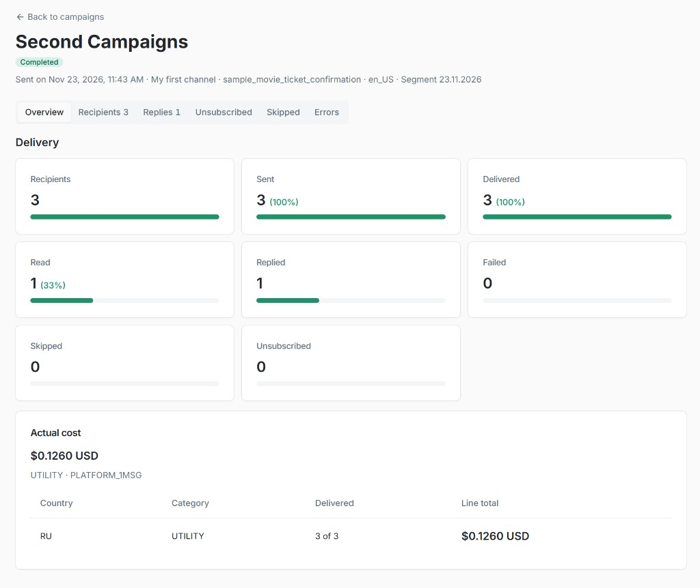
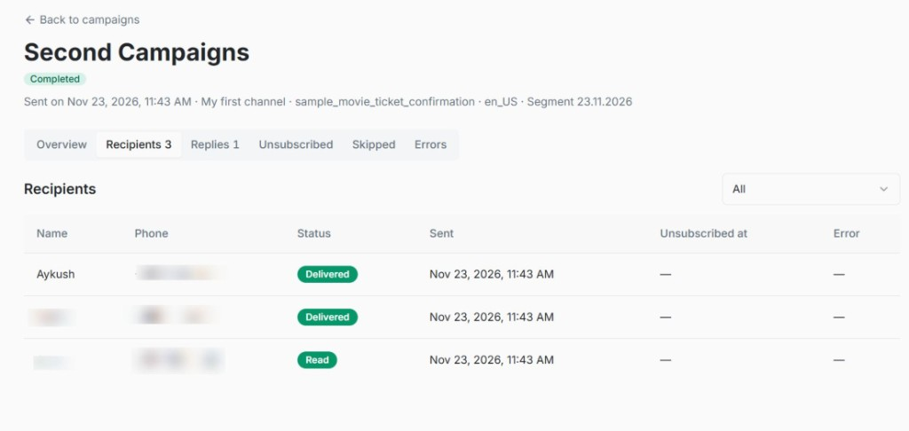
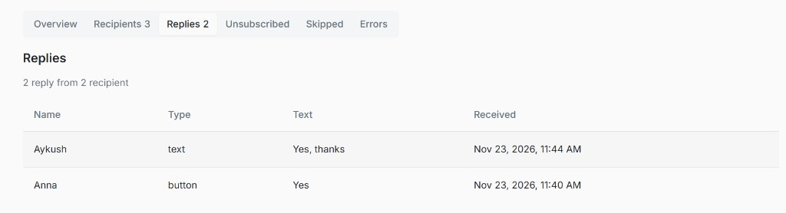
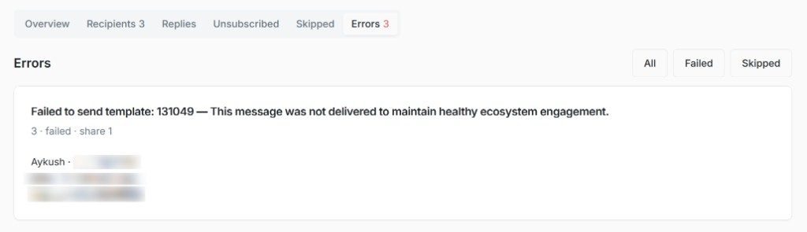

Откройте отправленную рассылку в [Campaigns](https://platform.1msg.io/messaging/campaigns).

В разделе информации о рассылке под заголовком сразу увидите бейдж статуса, время отправки, канал, шаблон, язык и сегмент.

## Overview

Карточки **Delivery** собирают воронку. У каждой число и доля от всех получателей.

- **Recipients** — сколько человек было в этой отправке
- **Sent** — сколько сообщений ушло
- **Delivered** — сколько дошло до телефона
- **Read** — сколько прочитали
- **Replied** — сколько ответили
- **Failed** — сколько не отправилось
- **Skipped** — сколько рассылка пропустила
- **Unsubscribed** — сколько отписались

Полоски рядом с цифрами показывают это же на глаз. Например, сообщение ушло троим и дошло троим, а прочитал один.

**Actual cost** — это уже не прогноз со шага проверки, а сумма, которая списалась. Ниже разбивка: страна, категория шаблона, сколько из скольких доставлено и сумма строки. На экране это выглядит так: страна RU, категория UTILITY, доставлено 3 из 3.

## Recipients

Вкладка **Recipients** — список по людям, а не общая цифра. У каждого имя, телефон, статус, время в колонке **Sent**, время отписки в **Unsubscribed at** и текст в **Error**, если он есть. Статус бывает, например, **Delivered** или **Read**: сообщение дошло, а у кого-то ещё и открыто. Справа фильтр, по умолчанию **All**.

## Replies

Вкладка **Replies** показывает, кто ответил и чем. Колонка **Type**: **text**, если человек написал сообщение, **button**, если нажал кнопку. Рядом текст ответа и время в **Received**. Например, один получатель написал «Yes, thanks», а Анна нажала кнопку «Yes». Сверху видно, сколько ответов и от скольких людей.

## Errors

Вкладка **Errors** собирает причины, почему сообщение не ушло. Текст приходит от Meta, вместе с кодом, и под ним люди, которых эта причина коснулась. Фильтры **All**, **Failed** и **Skipped** отделяют ошибки отправки от пропусков.

Например, Meta может написать: сообщение не доставлено, чтобы сохранить здоровое вовлечение, код 131049. Формулировка стоит на экране, отдельно её искать не нужно.

## Unsubscribed и Skipped

Вкладки **Unsubscribed** и **Skipped** собирают тех, кто отписался, и тех, кого рассылка пропустила. Те же числа уже стоят карточками на **Overview**.
