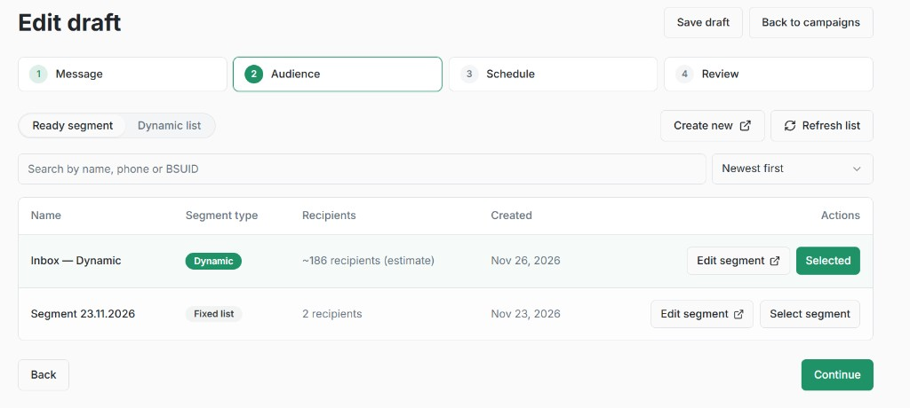
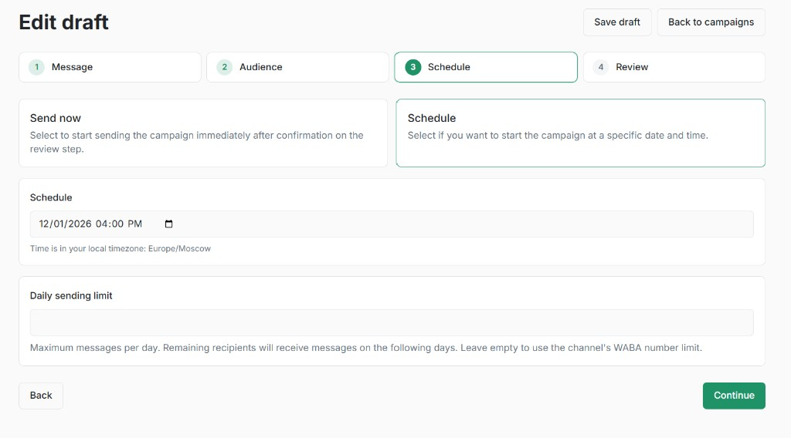
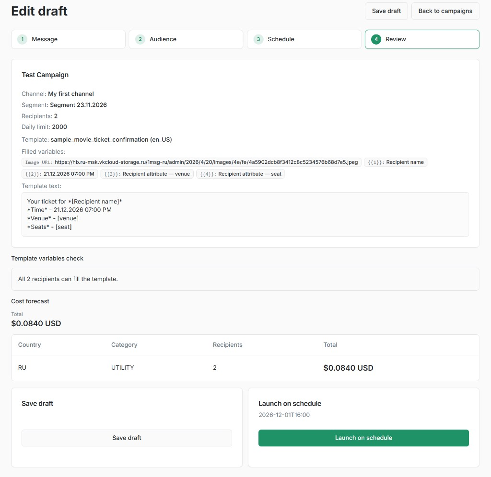

Open [Campaigns](https://platform.1msg.io/messaging/campaigns) and click **New campaign**. The draft has four steps. **Save draft** keeps it, and **Back to campaigns** returns to the list.

## 1. Message

Set the broadcast name, the channel, and the message type. For a template, choose it and fill in the variables. A variable is either the same text for every recipient or a person's attribute. Write the attribute name without braces or a prefix, for example `order`. The value comes from the segment on the next step.

The preview on the right shows the message as the recipient will see it.

**Delivery window (seconds)** sets how many seconds the message stays relevant.

Under **Exclusions** you can skip people on the stoplist and blocked contacts.

## 2. Audience

Use an audience you already have, or build one here.

**Ready segment.** Choose a segment that already exists and click **Select segment**. On the chosen one the button becomes **Selected**.

**Dynamic list.** Set the conditions in the draft. The segment is saved on its own, under the broadcast's name, and selected for this send. Recipients come from Inbox dialogs and are calculated again when the broadcast is sent. **All conditions (AND)** keeps people who match every condition. **Any condition (OR)** keeps people who match any one of them. For example, a channel and an open dialog. Then click **Create segment and select**.

## 3. Schedule

**Send now** starts sending right after you confirm it on the next step.

**Schedule** sets a date and time. The time is in your time zone.

**Daily sending limit** is how many messages go out per day. The rest receive the message on the following days. An empty field means the WABA number's own limit.

## 4. Review

Check the name, channel, segment, recipient count, daily limit, template, and variables. You also see whether everyone has the data the template needs, and the cost forecast.

You can save the draft again. If a time was chosen, sending starts with **Launch on schedule**.

