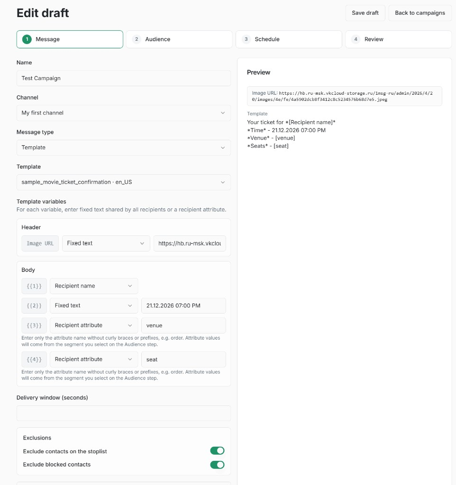
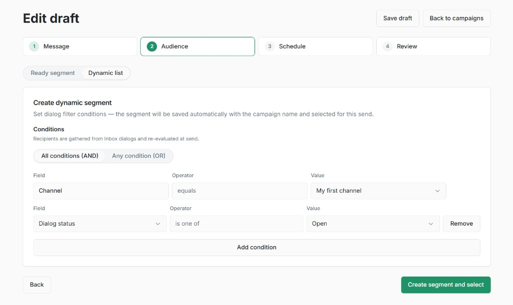

Open [Campaigns](https://platform.1msg.io/messaging/campaigns) and click **New campaign**. The draft has four steps. **Save draft** keeps it, and **Back to campaigns** returns to the list.

## 1. Message

Set the campaign name, the channel, and the message type. If it is a template, choose it and fill in the variables. A variable has two options:

- the same text for every recipient
- Contact name
- A person's attribute. Write the attribute name without braces or a prefix, for example `order`. The value comes from the segment on the next step.

The preview on the right shows the message.

**Delivery window (seconds)** sets how many seconds the message stays relevant after a successful send. For example, you set 24 hours (86400 s). If more than 24 hours pass after the message is sent, Meta will no longer try to deliver it.

**Exclusions**. In the **Exclusions** block you can skip people who are:

- on the stoplist
- blocked contacts.

## 2. Audience

Use an audience you already have, or build one here.

**Ready segment.** Choose a segment that already exists and click **Select segment**. On the chosen one the button becomes **Selected**.

**Dynamic list.** Set the conditions right in the draft. The segment is saved on its own, under the campaign's name, and selected for this send. Recipients come from Inbox dialogs and are calculated again when the campaign is sent.

**All conditions (AND)** keeps people who match every condition at once.

**Any condition (OR)** keeps people who match any one of them. For example, a channel and an open dialog.

Then click **Create segment and select**.

## 3. Schedule

**Send now** starts sending right after you confirm it on the next step.

**Schedule** sets a date and time. The time is in your time zone.

**Daily sending limit** is how many messages go out per day. The rest receive the message on the following days. An empty field means the WABA number's own limit.

For example, your WABA number limit is 2000 dialogs / 24h. You uploaded 3500 contacts. On the first day the campaign goes to 2000 contacts, and on the next day to another 1500.

## 4. Review

Check the name, channel, segment, recipient count, daily limit, template, and variables. You also see whether everyone has the data the template needs, and the cost forecast.

You can save the draft again. If a time was chosen, sending starts with **Launch on schedule** and sets the schedule. Otherwise it sends right away.

## What next

When the campaign has gone out, open [Campaign analytics](./analytics.md): delivery, replies, and errors are there.
