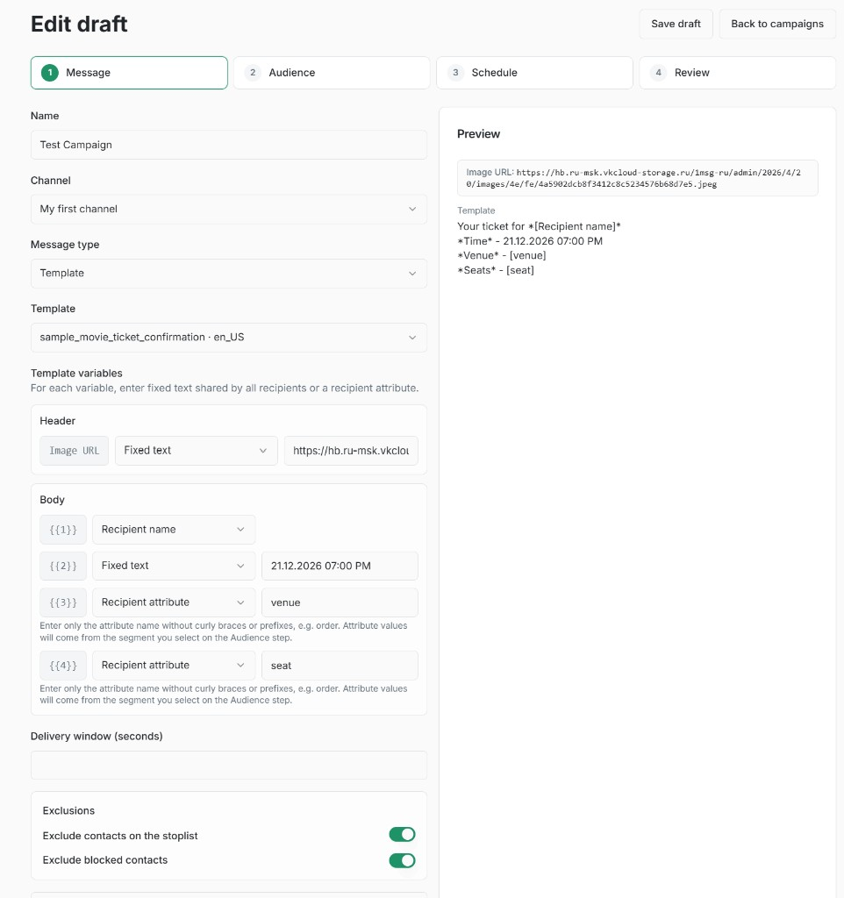
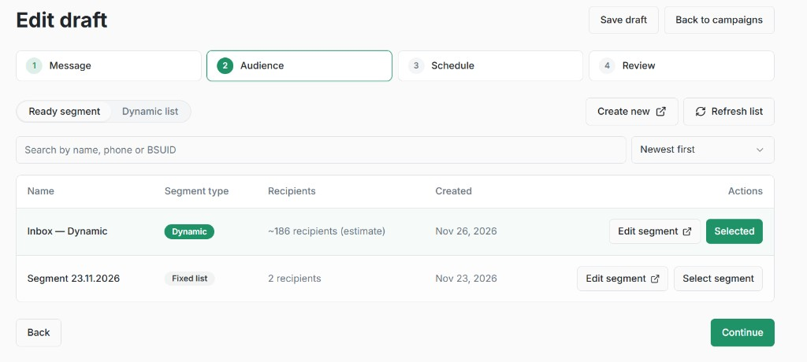
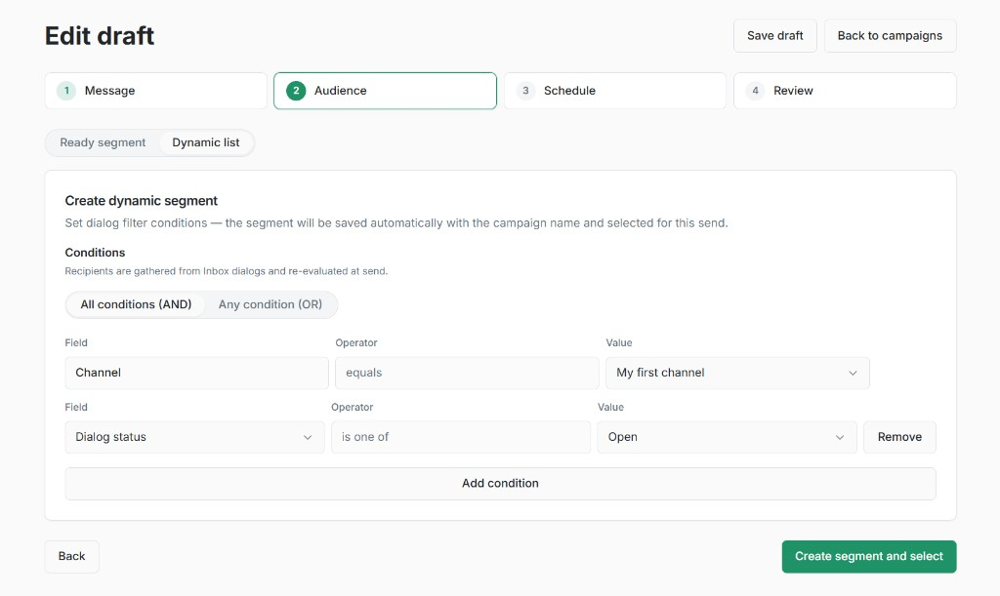
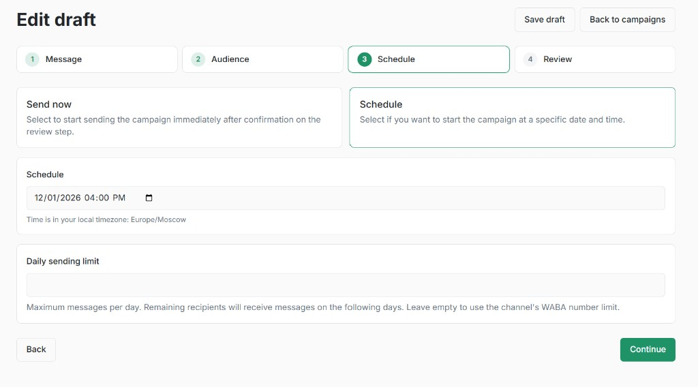
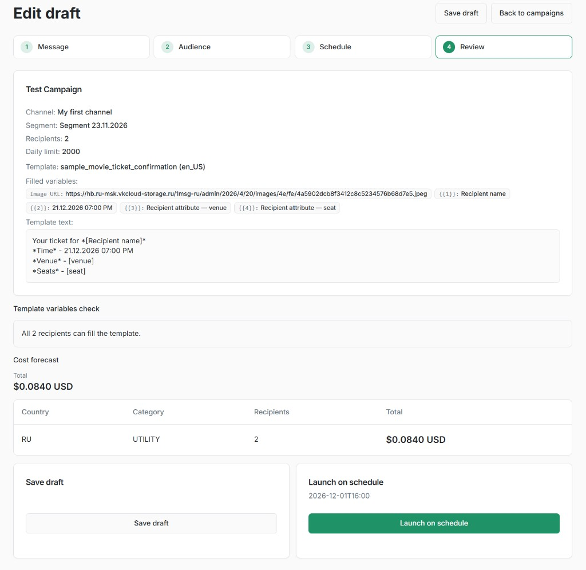

Перейдите в [Campaigns](https://platform.1msg.io/messaging/campaigns) и нажмите **New campaign**. Черновик собирается в четыре шага. Его можно сохранить кнопкой **Save draft** и вернуться к списку через **Back to campaigns**.

## 1. Message

Укажите имя рассылки, канал и тип сообщения. Если это шаблон, выберите его и заполните переменные. У переменной два варианта: общий текст для всех получателей или атрибут человека. Имя атрибута пишется без скобок и приставок, например `order`. Значение возьмётся из сегмента на следующем шаге.

Справа превью показывает сообщение так, как его увидит получатель.

**Delivery window (seconds)** задаёт, сколько секунд сообщение остаётся актуальным.

В блоке **Exclusions** можно не отправлять тем, кто в стоп-листе, и заблокированным контактам.

## 2. Audience

Аудиторию можно взять готовую или собрать сразу здесь.

**Ready segment.** Выберите уже созданный сегмент и нажмите **Select segment**. У выбранного кнопка меняется на **Selected**.

**Dynamic list.** Задайте условия прямо в черновике. Сегмент сохранится сам, с именем рассылки, и будет выбран для этой отправки. Получатели берутся из диалогов Inbox и пересчитываются в момент отправки. **All conditions (AND)** оставляет тех, кто подходит под все условия сразу, **Any condition (OR)** — под любое. Например, канал и открытый диалог. Затем нажмите **Create segment and select**.

## 3. Schedule

**Send now** запускает отправку сразу после подтверждения на следующем шаге.

**Schedule** ставит дату и время. Время берётся в вашем часовом поясе.

**Daily sending limit** — сколько сообщений уходит в день. Остальные получат сообщение в следующие дни. Пустое поле значит лимит номера WABA.

## 4. Review

Проверьте имя, канал, сегмент, число получателей, дневной лимит, шаблон и переменные. Отдельно видно, всем ли хватает данных, чтобы заполнить шаблон, и прогноз стоимости.

Черновик можно ещё раз сохранить. Если выбрано время, отправка запускается кнопкой **Launch on schedule**.

