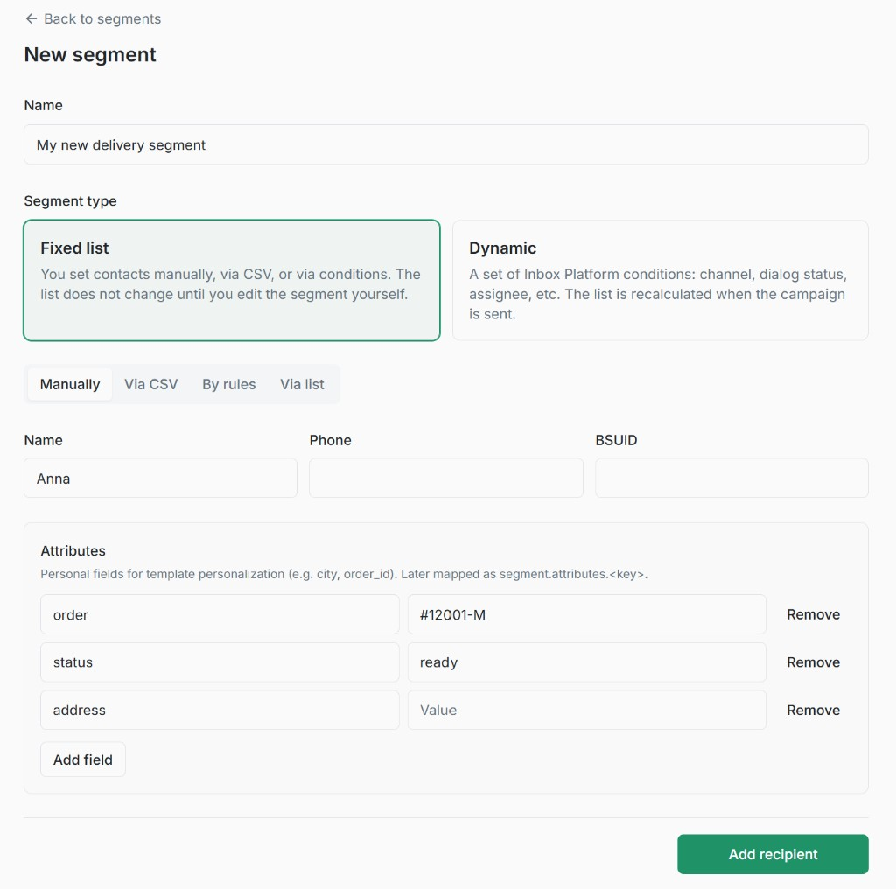
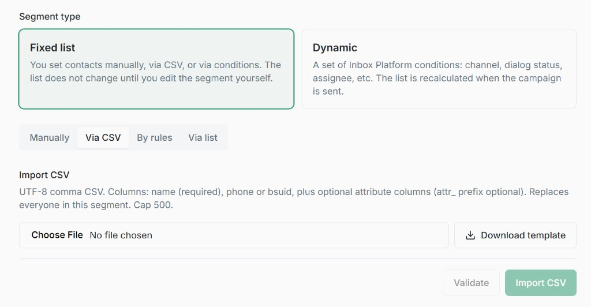
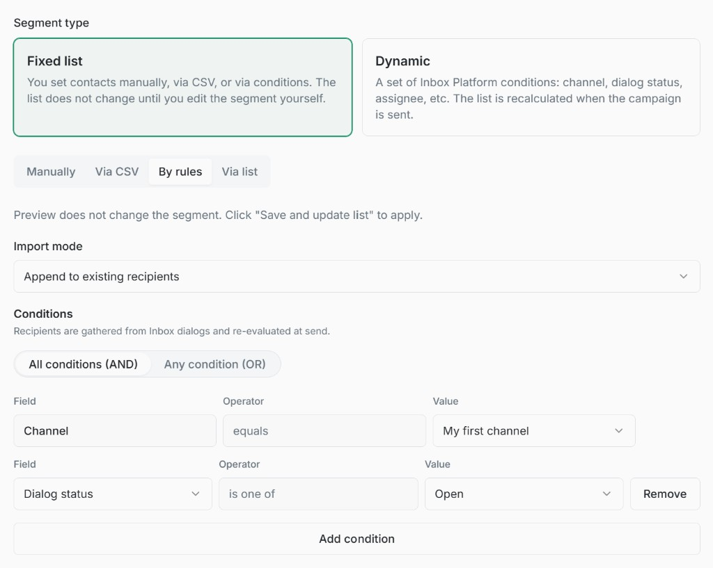
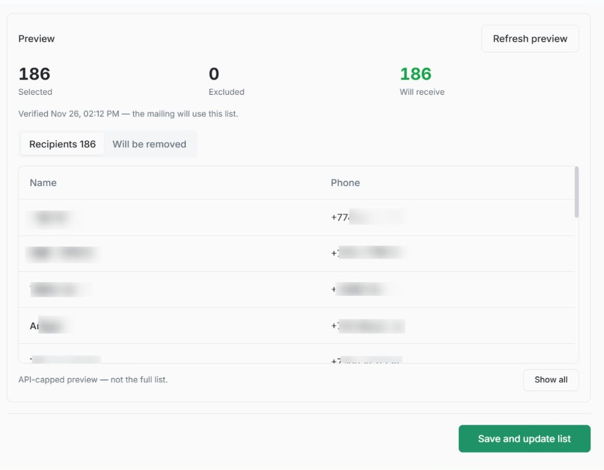
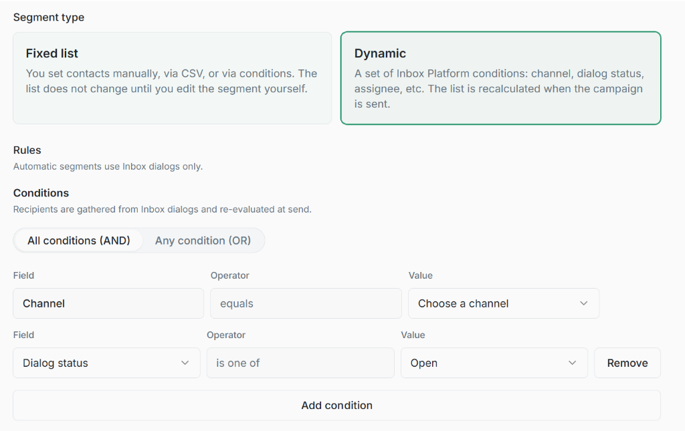
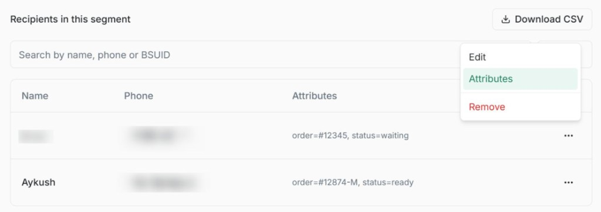

A segment is who receives the campaign. You can write the list once, or build it from Inbox rules at the moment of sending.

## Fixed list

You add the people yourself. Until you change the list, the campaign goes to exactly them.

**By hand.** In [New segment](https://platform.1msg.io/messaging/campaigns/segments/new) choose **Fixed list** and the **Manually** tab. For each person, enter a name and a phone number or a BSUID. The number and the BSUID are the recipient's address; one of them is enough.

**Attributes.** These are personal fields that are inserted into the template: an order, a status, an address. Anna's order field is 1234, and the message comes out as: "Anna, your order #1234 is on the way." If there is no value, the person does not receive a message with an empty spot.

**CSV upload.** On the **Via CSV** tab, upload a file. The columns are name, phone or BSUID, and attributes if you need them. A sample is downloaded with **Download template**. The file replaces the current list, and it holds no more than 500 people.

**A selection from Inbox.** On the **By rules** tab, set a condition, for example every open dialog of the channel. The preview shows who the system found, and it does not change the list by itself. Those people join the segment after **Save and update list**, and they are added to the people already there. After that the list is an ordinary fixed list: it is not rebuilt on its own.

## Dynamic list

Choose **Dynamic**. Above the conditions it says: this kind of segment takes only Inbox dialogs.

**Conditions.** **All conditions (AND)** keeps people who match every rule at once. **Any condition (OR)** keeps people who match any one of them. For example, the channel equals your channel, and the dialog status is **Open**. A condition can be added and removed.

The list is not stored ahead of time. When the campaign is sent, it is taken from Inbox again and fixed. The segment works only for people who use Inbox.

Before you save, open the preview and see who would be on the list now. By the time of sending the set may be different: it is taken again.

## Who is already in the segment

Open the segment: the list that is in it now is there. You can edit a person separately, change their attributes, or remove them from the segment. **Download CSV** downloads this list.

## What next

The segment is ready. You can go on to create the campaign. How to do that is described in [Create a campaign](./create.md).

[Platform → Campaigns](https://platform.1msg.io/messaging/campaigns). Open the [campaign list](https://platform.1msg.io/messaging/campaigns) right away.
