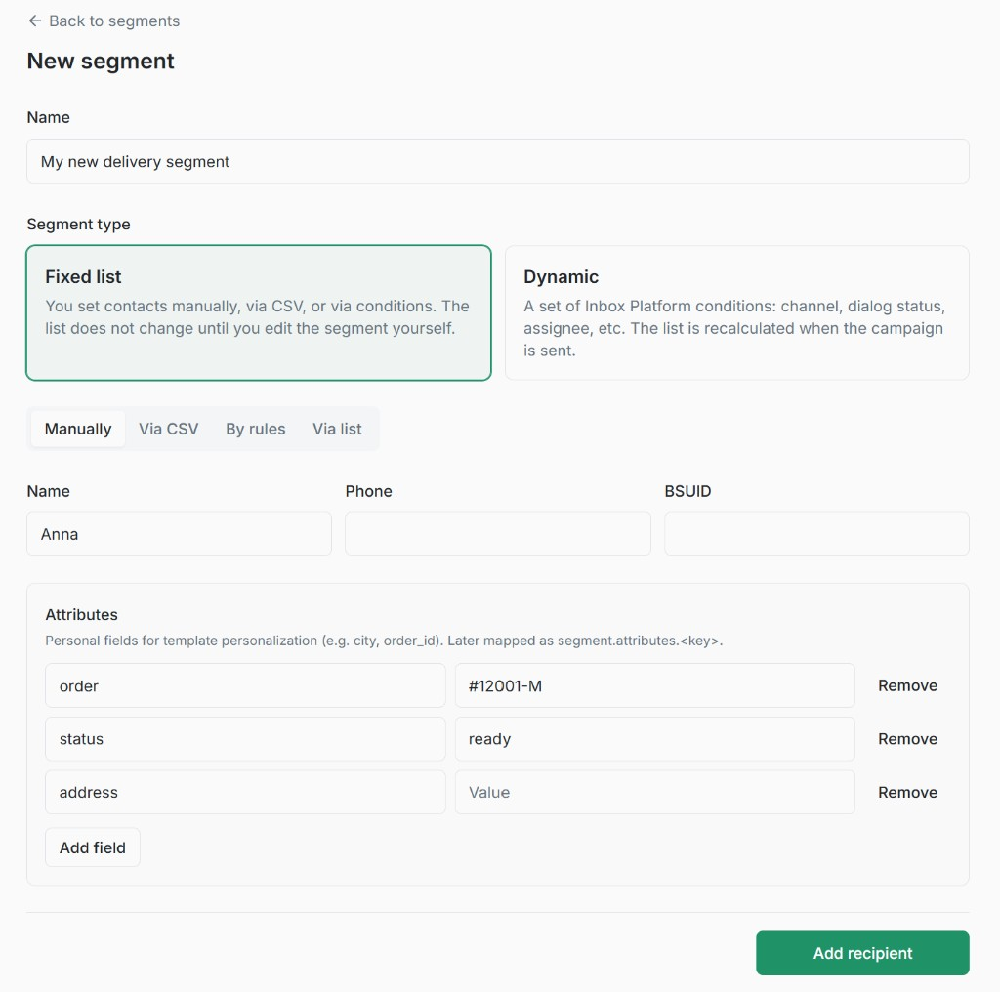
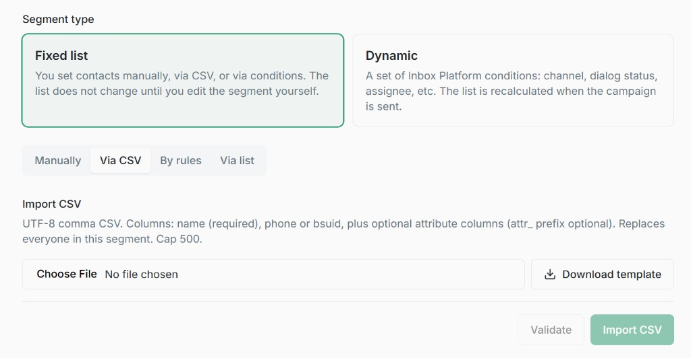
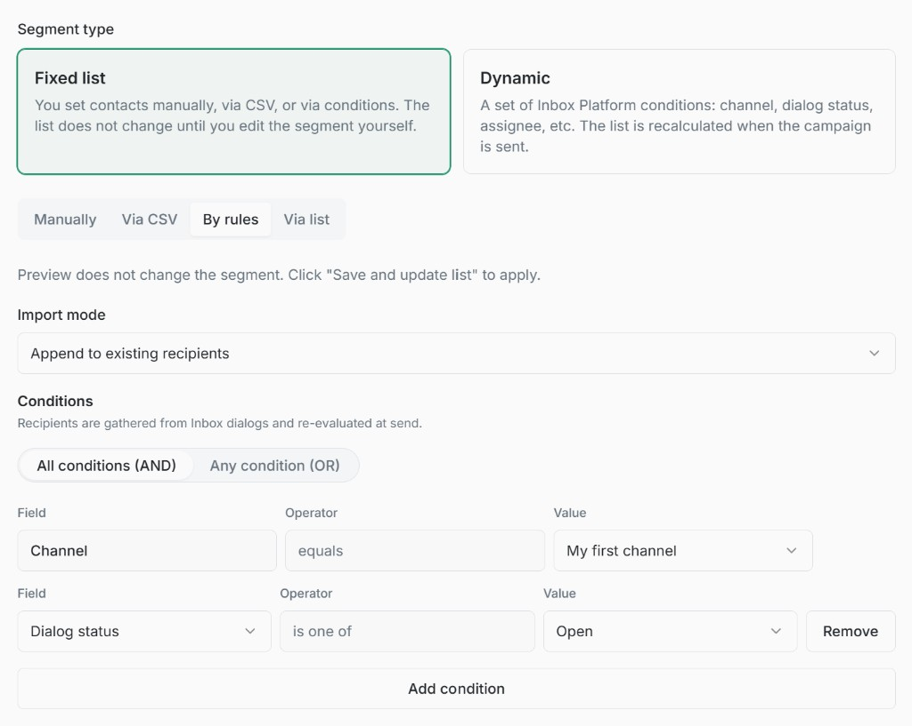
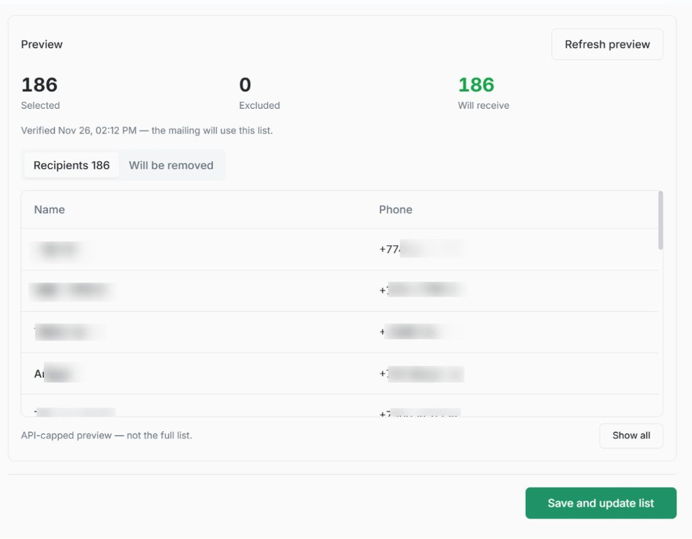
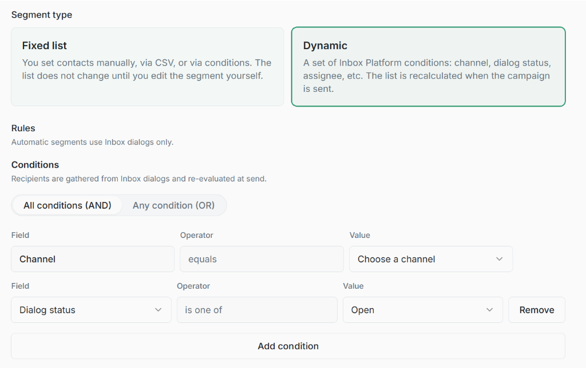
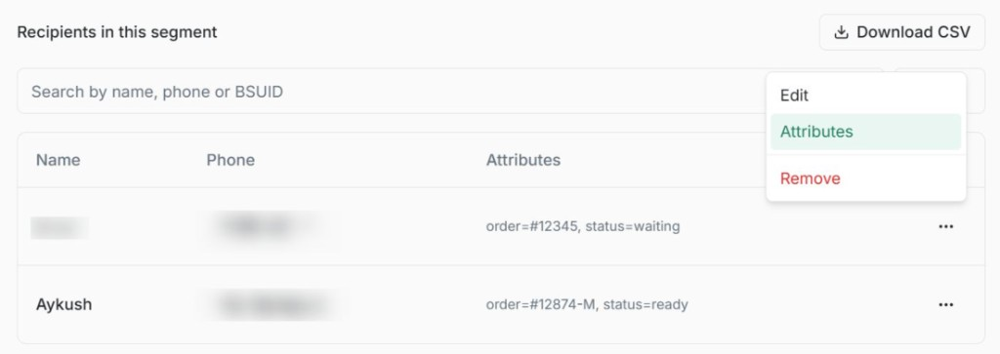

Сегмент — это кому уйдёт рассылка. Список можно записать один раз или собрать по правилам Inbox в момент отправки.

## Фиксированный список

Людей вы добавляете сами. Пока вы не измените список, рассылка уходит именно им.

**Вручную.** В [New segment](https://platform.1msg.io/messaging/campaigns/segments/new) выберите **Fixed list** и вкладку **Manually**. У каждого укажите имя и телефон или BSUID. Номер и BSUID — это адрес получателя, достаточно одного из них.

**Атрибуты.** Это личные поля, которые подставятся в шаблон: заказ, статус, адрес. У Анны в поле заказа стоит 1234, и сообщение получается таким: «Анна, ваш заказ №1234 уже в пути». Если значения нет, человек не получит сообщение с пустым местом.

**Загрузка CSV.** На вкладке **Via CSV** загрузите файл. В колонках имя, телефон или BSUID и, если нужно, атрибуты. Образец скачивается кнопкой **Download template**. Файл заменяет текущий список, в нём не больше 500 человек.

**Выборка из Inbox.** На вкладке **By rules** задайте условие, например все открытые диалоги канала. Превью показывает, кого система нашла, и само список не меняет. В сегмент эти люди попадут после **Save and update list** и добавятся к тем, кто уже есть. Дальше список обычный фиксированный: сам он больше не пересобирается.

## Динамический список

Выберите **Dynamic**. Над условиями написано: такой сегмент берёт только диалоги Inbox.

**Условия.** **All conditions (AND)** оставляет тех, кто подходит под все правила сразу. **Any condition (OR)** — под любое из них. Например, канал равен вашему каналу, а статус диалога — **Open**. Условие можно добавить и убрать.

Список не хранится заранее. В момент отправки рассылки он заново снимается с Inbox и фиксируется. Сегмент работает только у тех, кто пользуется Inbox.

До сохранения откройте превью и посмотрите, кто попадёт в список сейчас. К отправке состав может стать другим: он снимается заново.

## Кто уже в сегменте

Откройте сегмент: там список, который в нём сейчас. Человека можно поправить отдельно, изменить его атрибуты или удалить из сегмента. **Download CSV** скачивает этот список.

## Что дальше

Сегмент готов. Теперь можно перейти к созданию рассылки. Как это сделать, описано в статье «Как создать рассылку».

[Platform → Список рассылок](https://platform.1msg.io/messaging/campaigns). Сразу открыть [список рассылок](https://platform.1msg.io/messaging/campaigns).
