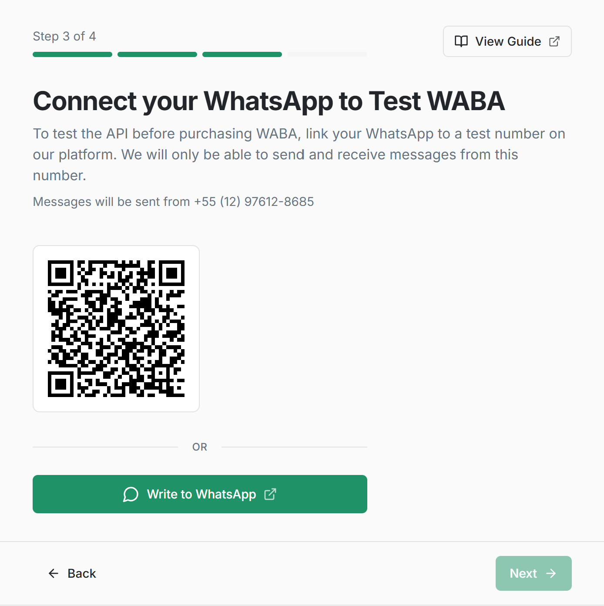
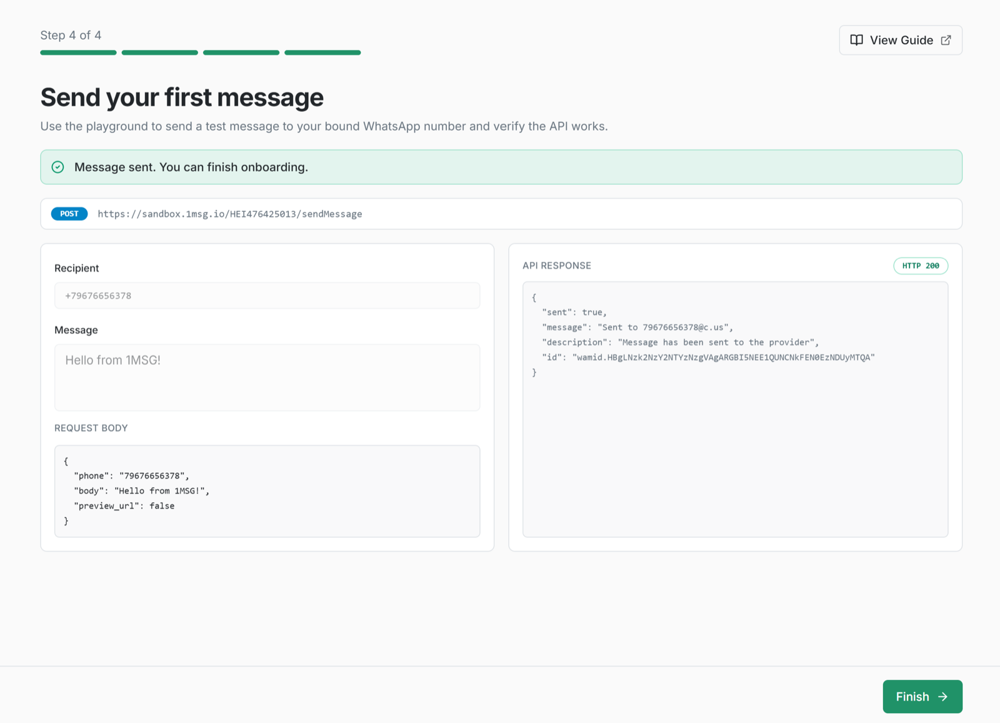

This guide walks you from sending a test message to full use of WhatsApp Business API (WABA) in seven simple steps.

## Step 1. Create an account

You need an account on **platform.1msg.io** to get started.

Go to the [registration page](https://platform.1msg.io/register?utm=qst), enter your email and password, and click **Sign up**. Alternatively, use the Facebook icon below the registration form.

## Step 2: Activate the Test channel

You don’t have to wait for Meta approval — start testing right away.

1. Scan the QR code in your dashboard or click **"Write to WhatsApp"** and send the generated code to the test WABA number.



2. Your account will automatically connect to the test WABA channel.
3. You can chat with your phone number on WhatsApp.

✅ **Test channel is ready.** A **$5** bonus has been credited to your balance for testing paid templates and sessions.

### Why use the Test channel?

Connect to our pre-configured WABA test number — no Meta approval or additional setup required.

* send and receive WhatsApp messages;
* test webhooks and API methods;
* verify your integration flow before connecting your own WABA number.

**Test limitations:**

* Messages can be sent only to your own WhatsApp numbers.

## Step 3: Send your first message

Once your test channel is created, you can send your first API message.

Click **"Send"** and check the message in your WhatsApp chat with the test WABA number.



**Example request**

```http
POST https://platform.1msg.io/{{channel_id}}/sendMessage?token=••••••••
```

You can find your **channel ID** and **token** on the channel page.

**Request body (JSON):**

```json
{
    "phone": "your_phone_number",
    "body": "Hello 1msg",
    "preview_url": false
}
```

You can find more API methods in **Playground**

## Step 4: Try more API methods in Playground

In a couple of minutes, verify that the messaging API works end to end.

1. Open [Playground](https://platform.1msg.io/dashboard/playground).
2. Send another message in one click and receive it instantly on your WhatsApp number.
3. In the UI you’ll see a ready-made JSON request you can use in your code, plus the send response and the webhook payload.

## Step 5: Configure webhooks

Teach your system to “listen” to WhatsApp.

1. Set your webhook URL in the channel settings.
2. Incoming messages, delivery statuses (sent, delivered, read), and profile changes will be delivered to your server in real time.
3. Test webhook handling in your integration using webhook simulation from [Playground](https://platform.1msg.io/dashboard/playground).

## Step 6: API, SDK, and developer tools

Once the flow is clear, move on to automation. Use our resources to ship faster:

- [**API documentation**](https://docs.1msg.io/) — full description of all methods in OpenAPI format
- [**SDK**](https://github.com/1msg/1msg-sdk) — ready-made libraries for Node.js, Python, and PHP with code examples.
- [**MCP (Model Context Protocol)**](https://github.com/1msg/1msg-mcp) — connect our API directly to your AI assistant (Cursor, Claude Desktop) to generate integration code on the fly.
- [**CLI**](https://github.com/1msg/1msg-cli) — turns WhatsApp Business API methods into commands you run in a terminal. It is the same API as the SDK and MCP

## Step 7: Go to production

Ready to launch for real customers?

1. In the left menu, go to **Add new channel**.
2. Choose a plan for your channel and pay the subscription via Stripe in the dashboard.
3. Connect your own number: use the Embedded Signup flow to register your business number with Meta quickly.
4. Configure API, webhooks, and message templates — then start broadcasts, chatbots, and everything else the 1MSG API offers.

For a tutorial on connecting a WABA channel, see:

[Connection WABA](../whatsapp/connect-waba/README.md)
