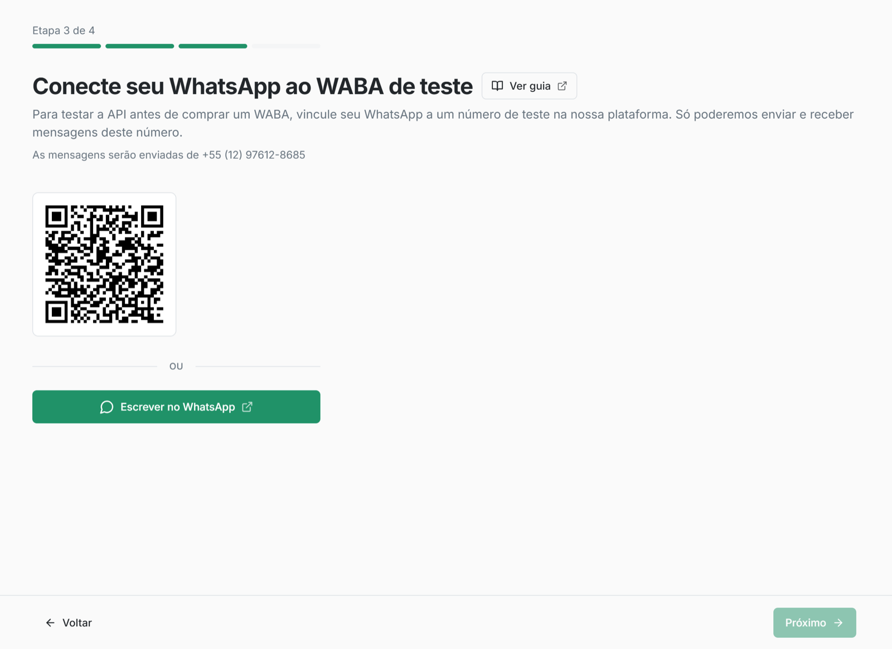
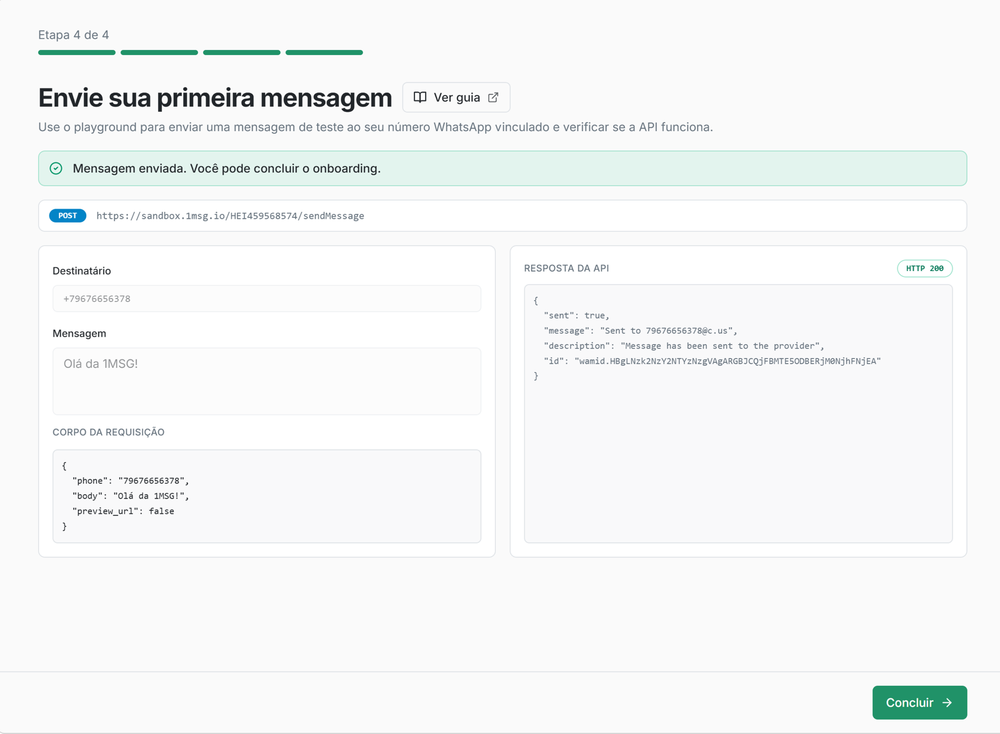

Este guia leva você do envio de uma mensagem de teste ao uso completo da WhatsApp Business API (WABA) em seis passos simples.

## Passo 1. Crie uma conta

Você precisa de uma conta em **platform.1msg.io** para começar.

Acesse a [página de cadastro](https://platform.1msg.io/register?utm=qst), informe seu e-mail e senha e clique em **Entrar**. Você também pode usar o ícone do Facebook abaixo do formulário.

## Passo 2: Ative o canal Teste

Você não precisa esperar a aprovação da Meta — comece a testar agora.

1. Escaneie o QR code no painel ou clique em **"Escrever no WhatsApp"** e envie o código gerado para o número WABA de teste.



2. Sua conta será conectada automaticamente ao canal WABA de teste.
3. Você pode conversar pelo WhatsApp com o seu número.

✅ **O canal Test está pronto.** Um bônus de **$5** foi creditado no seu saldo para testar templates pagos e sessões.

**Por que usar o canal Teste?**

Conecte-se ao nosso número WABA de teste já configurado — sem aprovação da Meta e sem setup extra.

* enviar e receber mensagens no WhatsApp;
* testar webhooks e métodos da API;
* validar o fluxo da sua integração antes de conectar o próprio número WABA.

**Limitações do Teste:**

* As mensagens só podem ser enviadas para os seus próprios números WhatsApp.

## Passo 3: Envie sua primeira mensagem

Com o canal de teste criado, você já pode enviar a primeira mensagem pela API.

Clique em **"Enviar"** e confira a mensagem no chat do WhatsApp com o número WABA de teste.



**Exemplo de requisição**

```http
POST http://platform.1msg.io/{{channel_id}}/sendMessage?token=••••••••
```

O **channel ID** e o **token** estão na página do canal.

**Corpo da requisição (JSON):**

```json
{
    "phone": "your_phone_number",
    "body": "Hello 1msg",
    "preview_url": false
}
```

Há mais métodos da API no **Playground**

## Passo 4: Experimente mais métodos da API no Playground

Em poucos minutos, confira se a messaging API funciona de ponta a ponta.

1. Abra o [Playground](https://platform.1msg.io/dashboard/playground).
2. Envie outra mensagem com um clique e receba na hora no seu número WhatsApp.
3. Na interface você vê um JSON pronto para usar no código, além da resposta do envio e do payload do webhook.

## Passo 5: Configure os webhooks

Ensine seu sistema a “ouvir” o WhatsApp.

1. Defina a URL do webhook nas configurações do canal.
2. Mensagens recebidas, status de entrega (enviado, entregue, lido) e mudanças de perfil chegam ao seu servidor em tempo real.
3. Teste o tratamento de webhook na sua integração com a simulação de webhook do [Playground](https://platform.1msg.io/dashboard/playground).

## Passo 6: API, SDK e ferramentas para desenvolvedores

Quando o fluxo estiver claro, passe para a automação. Use nossos recursos para entregar mais rápido:

- [**Documentação da API**](https://docs.1msg.io/) — descrição completa de todos os métodos no formato OpenAPI

**Coleção Postman**

- [**SDK**](https://github.com/1msg/1msg-sdk) — bibliotecas prontas para Node.js, Python e PHP, com exemplos de código.
- [**MCP (Model Context Protocol)**](https://platform.1msg.io/pt/dashboard/mcp) — conecte nossa API direto ao seu assistente de IA (Cursor, Claude Desktop) para gerar código de integração na hora.

## Passo 6: Vá para produção

Pronto para lançar para clientes de verdade?

1. No menu à esquerda, acesse **Adicionar novo canal.**
2. Escolha um plano para o canal e pague a assinatura via Stripe no painel.
3. Conecte o seu número: use o fluxo Embedded Signup para registrar o número da empresa na Meta com rapidez.
4. Configure API, webhooks e templates de mensagem — e comece disparos, chatbots e tudo o mais que a API 1MSG oferece.

Para um tutorial de conexão de um canal WABA, veja:

[Conexão da WABA](../whatsapp/connect-waba/README.pt.md)
