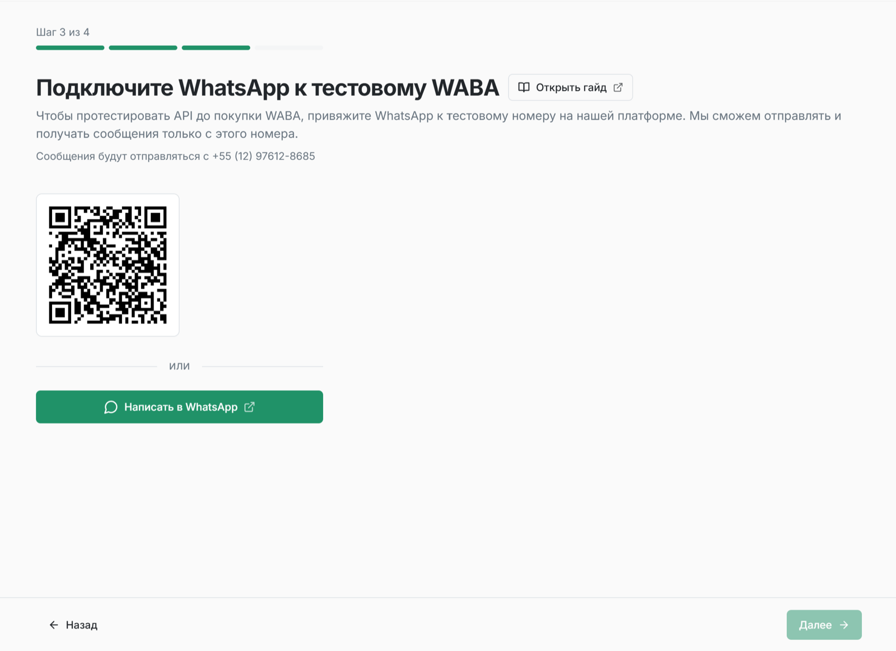
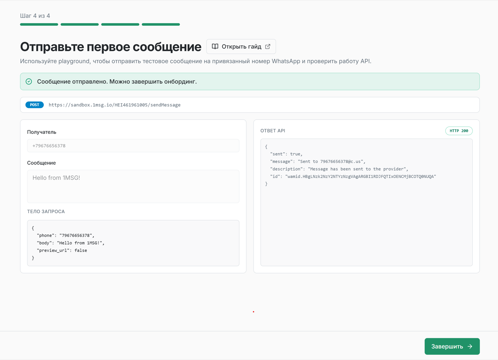

Это руководство проведёт вас от отправки тестового сообщения до полноценной работы с WhatsApp Business API (WABA) за семь простых шагов.

## Шаг 1. Создайте аккаунт

Для начала вам нужен аккаунт на **platform.1msg.io**.

Перейдите на [страницу регистрации](https://platform.1msg.io/register?utm=qst), введите email и пароль и нажмите **Зарегистрироваться**. Или используйте иконку Facebook под формой регистрации.

## Шаг 2: Активируйте тестовый канал

Не нужно ждать одобрения Meta — можно начинать тестирование сразу.

1. Выберите "Создать тестовый канал". Отсканируйте QR-код в дашборде или нажмите **"Написать в WhatsApp"** и отправьте сгенерированный код на тестовый номер WABA.



2. Ваш аккаунт автоматически подключится к тестовому каналу WABA.
3. Вы сможете переписываться со своим номером в WhatsApp.

**Зачем использовать тестовый канал?**

Подключитесь к нашему уже настроенному тестовому номеру WABA — без одобрения Meta и дополнительной настройки.

* отправлять и получать сообщения WhatsApp;
* тестировать вебхуки и методы API;
* проверить интеграцию до подключения собственного номера WABA.

**Ограничения теста:**

* Сообщения можно отправлять только на свои номера WhatsApp.
* ограничена отправка шаблонных сообщений.

## Шаг 3: Отправьте первое сообщение

Когда тестовый канал создан, можно отправить первое сообщение через API.

Нажмите **"Отправить"** и проверьте сообщение в чате WhatsApp с тестовым номером WABA.



**Пример запроса**

```http
POST https://api.1msg.io/{{channel_id}}/sendMessage?token=••••••••
```

**Request body (JSON):**

```json
{
    "phone": "your_phone_number",
    "body": "Hello 1msg",
    "preview_url": false
}
```

Другие методы API смотрите в **Playground**.

## Шаг 4: Попробуйте другие методы API в Playground

За пару минут проверьте, что messaging API работает от начала до конца.

1. Откройте [Playground](https://platform.1msg.io/developers/playground).
2. Отправьте ещё одно сообщение в один клик и сразу получите его на свой номер WhatsApp.
3. В интерфейсе увидите готовый JSON-запрос для кода, ответ на отправку и payload вебхука.

## Шаг 5: Настройте вебхуки

Научите вашу систему «слушать» WhatsApp.

1. Укажите URL вебхука в настройках канала.
2. Входящие сообщения, статусы доставки (sent, delivered, read) и изменения профиля будут приходить на ваш сервер в реальном времени.
3. Проверьте обработку вебхуков в интеграции через симуляцию вебхука в [Playground](https://platform.1msg.io/dashboard/playground).

## Шаг 6: API, SDK и инструменты разработчика

Используйте наши ресурсы, чтобы быстрее выйти в прод:

- [**Документация API**](https://docs.1msg.io/) — полное описание всех методов в формате OpenAPI
- [**SDK**](../developer-tools/sdk.ru.md) — готовые библиотеки для Node.js, Python и PHP с примерами кода.
- [**MCP (Model Context Protocol)**](https://github.com/1msg/1msg-mcp) — подключите наш API напрямую к AI-ассистенту (Cursor, Claude Desktop), чтобы генерировать код интеграции на лету.
- [**CLI**](https://github.com/1msg/1msg-cli) — выполняйте действия одной командой в терминале. Подходит для скриптов, автоматизации и задач по расписанию. Не требует ИИ-помощника.
- [**Skills**](https://github.com/1msg/1msg-for-agents) — инструкции для ИИ-помощника по работе с 1MSG: от выбора инструмента и отправки сообщений до настройки вебхуков и поиска причин ошибок доставки.

## Шаг 7: Переход в Production

Готовы запускать для реальных клиентов?

1. В левом меню перейдите в **Добавить новый канал**.
2. Выберите план и оплатите подписку.
3. Подключите свой номер: через Embedded Signup быстро зарегистрируйте бизнес-номер в Meta.
4. Настройте API, вебхуки и шаблоны сообщений — затем запускайте рассылки, чат-ботов и всё остальное, что даёт API 1MSG.

Туториал по подключению канала WABA:

[Подключение WABA from 1MSG](../whatsapp/connect-waba/waba-from-1msg.ru.md)

[Подключение Bring your own WABA](../whatsapp/connect-waba/bring-your-own-waba.ru.md)
