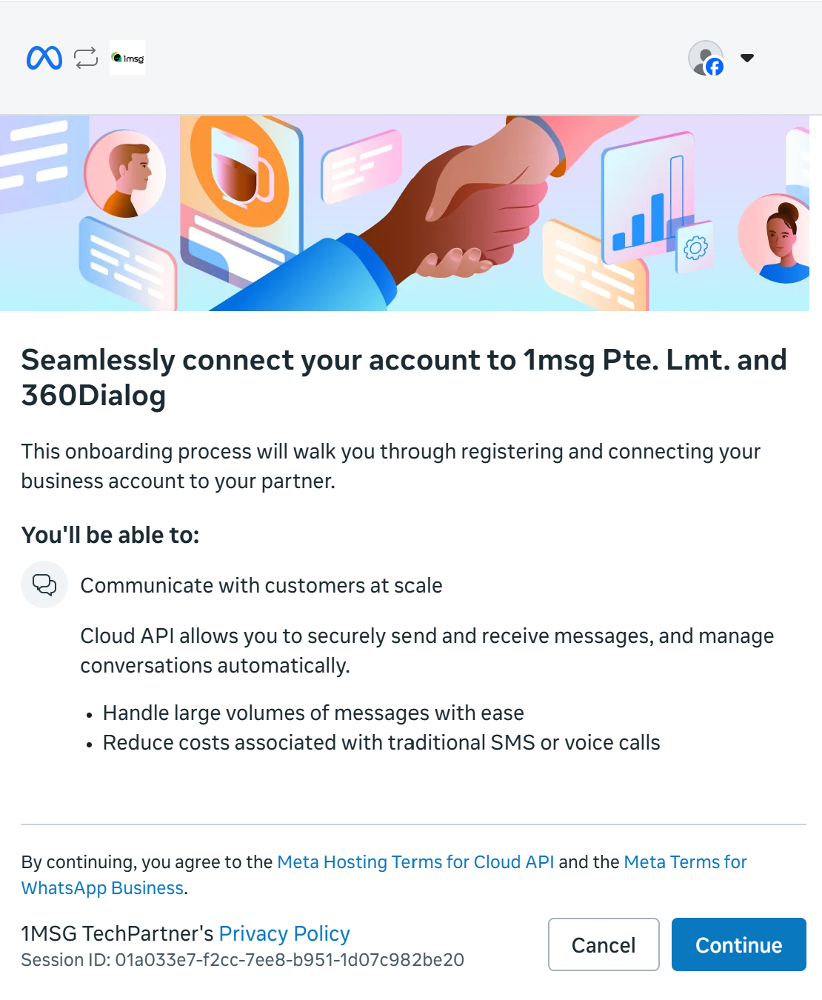
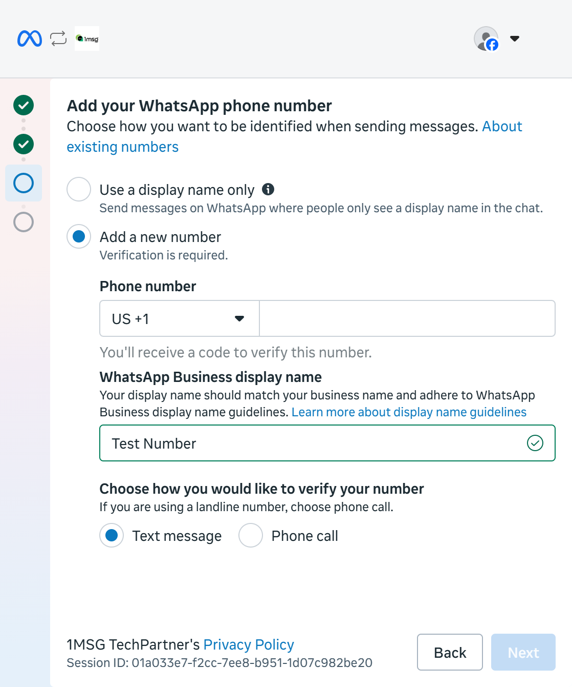

Este guia é para o plano própria WABA (Bring your own WABA): você conecta um número WhatsApp Business que já gerencia (ou vai criar) na Meta e usa todos os recursos da 1MSG incluídos no plano.

> [!NOTE]
> **Quando escolher própria WABA (Bring your own WABA, BYOW)**
>
> 1. Você já tem uma WABA no Meta Business Manager ou quer criar uma na **sua** conta Meta.
> 2. O uso de mensagens deve ser cobrado **pela Meta**, não pela 1MSG.
>
> ⚠️ **Importante:** você precisa adicionar uma forma de pagamento ao seu **Portfólio Empresarial**. Caso contrário, não poderá enviar mensagens.

## O que você precisa

* **Sua página pessoal do Facebook** — a partir dela você cria as contas Meta Business e WhatsApp Business.
* **Sua conta Meta Business.** Crie na [página do Facebook Business](https://business.facebook.com/) ou use uma que já exista.
* **Uma forma de pagamento para o seu Portfólio Empresarial** — adicione uma forma de pagamento válida ao seu Portfólio Empresarial da Meta. Recomendamos fazer isso **antes de conectar seu número e criar sua WABA** para evitar problemas durante o processo de configuração.
* **O número de telefone** que você quer vincular ao WABA.

> [!NOTE]
> Para adicionar uma forma de pagamento, acesse **Meta Business Portfolio → Settings → Billing & payments → Payment methods**.

Como preencher as informações da empresa no Meta Business Manager

Depois de criar as contas, abra o Meta Business. No primeiro portfólio você deve ver **Create a business portfolio** — clique nele.

Vá em **Business Settings** (menu inferior esquerdo) → **Business Info** → **Edit**.

Campos obrigatórios:

* **Company Name** — deve ser o mesmo nome legal que consta nos documentos de registro.
* **Company Website** — o rodapé do site deve trazer os dados legais e um telefone registrado em nome da empresa.
* **Company Email Address** — o domínio do site e o domínio do e-mail devem coincidir (por exemplo, `example.com` e `sales@example.com`).
* **Country, Address, Postal Code, City** — devem coincidir com o endereço legal da empresa. Mais adiante, na verificação da Meta, serão pedidos documentos desse endereço.
* **Company Phone Number** — pode ser o mesmo do WABA ou outro. A Meta pode pedir comprovação. Exiba esse número no cabeçalho ou no rodapé do seu site.

## O que você vai fazer (visão geral)

1. Cadastre-se no 1msg.io, escolha **Bring your own WABA**, inicie o plano por **$0** (um mês grátis, sem renovação automática).
2. Autorize a sua conta do Facebook.
3. Crie ou selecione as contas Meta Business e WhatsApp Business.
4. Verifique o número de telefone.
5. Antes do fim do mês grátis, abra o Stripe e **continue** a assinatura — senão o canal para.

Nesta etapa você **não** precisa verificar a empresa na Meta. Isso pode ser feito depois, para ampliar as opções de uso do número.

## Passo 1. Comece no 1msg.io — plano e checkout de $0

Depois do cadastro, escolha **Bring your own WABA** e clique em **Obtenha teste grátis de 30 dias**.

**Condições de pagamento:**

* **Primeiro mês.** O primeiro mês custa **$0**. Você ainda assim cadastra um cartão. Nada é cobrado agora.
* **Duração.** Um mês a partir da data do checkout.
* **Recorrência.** A assinatura **termina** quando o mês grátis acaba. O mês seguinte não é cobrado, a menos que você continue o plano.
* **Depois do mês grátis.** O preço mensal (ou anual) mostrado no card. Ele não começa sozinho. Se você não fizer nada, o canal **para** na data de término.

Saiba mais sobre os [planos de assinatura](https://help.1msg.io/platform-1msg/pt/primeiros-passos/planos-de-assinatura#condicoes-da-assinatura-own-waba) Bring your own WABA.

Em seguida:

1. Clique em **Começar assinatura por R$0.**
2. Escolha o plano e clique em **Conectar por R$ 0**.
3. Depois que o pagamento de $0 for concluído, clique em **Conectar WABA** e siga o embedded signup da Meta.

## Passo 2. Autorize a conta do Facebook

Entre com a sua página do Facebook.

## Passo 3. Contas Meta Business e WhatsApp Business

Escolha ou crie as contas Meta Business e WhatsApp Business. Clique em **Continue** e permita que a 1MSG gerencie a sua conta WhatsApp Business.

Selecione a conta Meta Business que você criou e informe o nome do WhatsApp Business.

Crie o perfil do WhatsApp Business: nome e categoria nas duas telas seguintes.

Verifique o número. Você pode receber o código por SMS ou por ligação internacional. Clique em **Send code** e digite o código.

Quando a verificação for concluída, você verá que o número está pronto.

## Passo 4. Autorize o 1MSG

Após concluir o processo de configuração, a Meta redirecionará você para a página do canal na 1MSG e solicitará que você informe o **PIN do WhatsApp**.

* Se você já tiver configurado um PIN para esse número, informe-o.
* Se você ainda não tiver configurado um PIN, crie um novo e salve-o em um local seguro.

**Não perca seu PIN:** ele é usado para proteger seu número com a **verificação em duas etapas** e pode ser necessário caso você precise registrar o número novamente.

Depois de informar o PIN, conclua a configuração do canal.

Você pode encontrar a **URL da API** e o **token JWT** em **Canal → Configurações**.

## Passo 5. Use o número

Você pode enviar e receber mensagens:

* [Shared Team Inbox](https://platform.1msg.io/dashboard/inbox)
* [API Docs](https://docs.1msg.io/)

## Depois que você estiver conectado

* **URL da API e JWT** — para o seu aplicativo.
* **Status da conta WABA** — verificação das políticas da Meta. Costuma ficar ok, a menos que o negócio seja restrito (álcool, tabaco, cripto, drogas e semelhantes).
* **Verificação da empresa no Facebook** — não é obrigatória neste primeiro onboarding.
* **Número de telefone** — o número vinculado ao canal.
* **WABA externa** — depois que a Meta recebe a conta, o status muda de `DRAFT` (cinza) para `DONE` (verde).
* **Verificação do display name** — o WhatsApp aceitou o nome da empresa; os clientes vão vê-lo mesmo que não esteja na lista de contatos.
* **Registro do número** — `Running` significa que o número está no ar.
