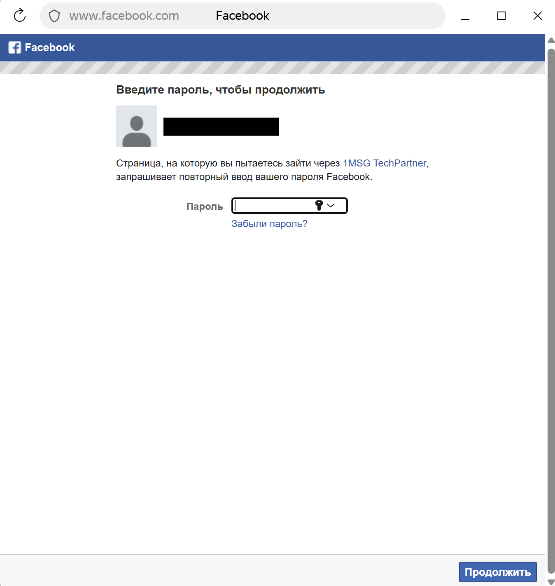
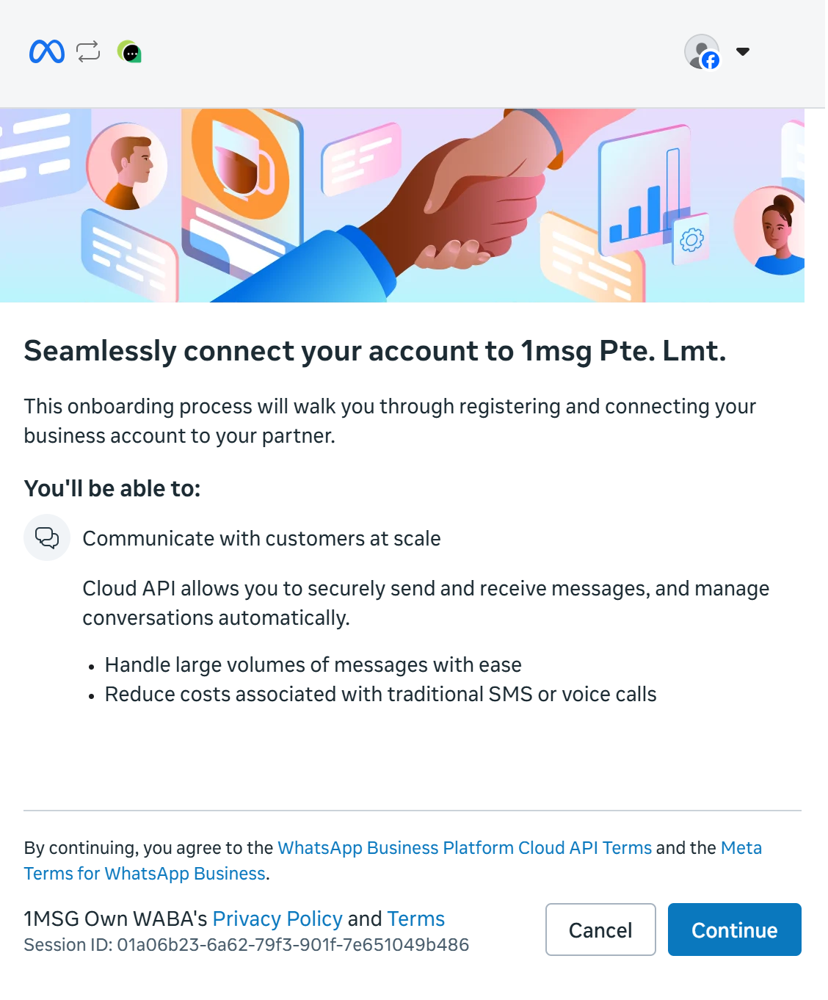
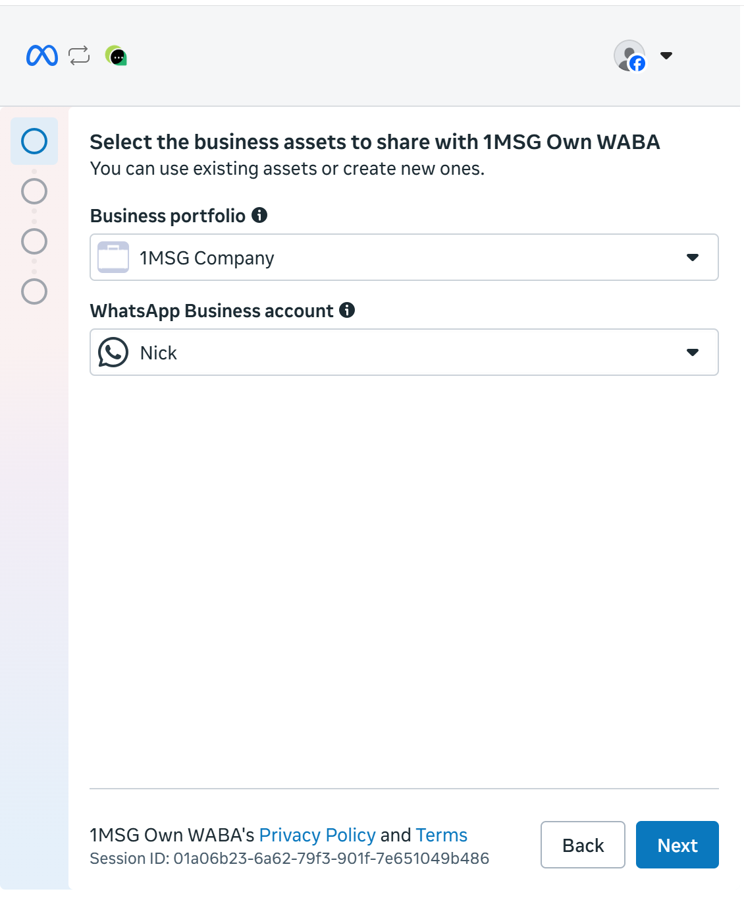
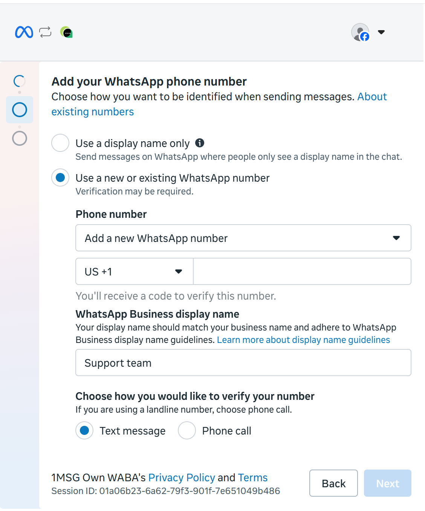

Это руководство для тарифа **Bring your own WABA**: вы подключаете номер WhatsApp Business, которым уже управляете (или который создадите) в Meta, и используете все возможности 1MSG из тарифа.

> [!NOTE]
> **Когда выбирать Bring your own WABA (BYOW)**
>
> 1. У вас уже есть WABA в Meta Business Manager, или вы хотите создать его в **своём** аккаунте Meta.
> 2. Хотите рассчитываться за расход за сообщения **через Meta**, а не через 1MSG.
>
> ⚠️**Важно:** в Business Portfolio нужно добавить способ оплаты. Иначе отправлять сообщения не получится.

## Что понадобится

* **Личная страница Facebook** — от неё создаются аккаунты Meta Business и WhatsApp Business.
* **Аккаунт Meta Business.** Создайте его на [странице Facebook Business](https://business.facebook.com/) или используйте существующий.
* **Способ оплаты в Business Portfolio** — добавьте действующий способ оплаты в Meta Business Portfolio. Рекомендуем сделать это **до подключения номера и создания WABA**, чтобы избежать проблем при настройке.
* **Номер телефона**, который вы хотите привязать к WABA.

> [!NOTE]
> Чтобы добавить способ оплаты, откройте **Meta Business Portfolio → Settings → Billing & payments → Payment methods**.

Как заполнить информацию о компании в Meta Business Manager

После создания аккаунтов откройте Meta Business. Для первого портфеля должна быть кнопка **Create a business portfolio** — нажмите её.

Перейдите в **Business Settings** (меню слева внизу) → **Business Info** → **Edit**.

Обязательные поля:

* **Company Name** — должно совпадать с юридическим названием в регистрационных документах.
* **Company Website** — в футере сайта должны быть юридические реквизиты и телефон, зарегистрированный на компанию.
* **Company Email Address** — домен сайта и домен email должны совпадать (например, `example.com` и `sales@example.com`).
* **Country, Address, Postal Code, City** — должны совпадать с юридическим адресом компании. При верификации Meta позже попросит документы по этому адресу.
* **Company Phone Number** — может совпадать с номером WABA или отличаться. Meta может запросить подтверждение. Разместите этот номер в шапке или футере сайта.

## Что нужно сделать (обзор)

1. Зарегистрироваться на 1msg.io, выбрать **Bring your own WABA**, начать тариф за **1 ₽**.
2. Авторизовать аккаунт Facebook.
3. Создать или выбрать аккаунты Meta Business и WhatsApp Business.
4. Подтвердить номер телефона.
5. До окончания бесплатного месяца откройте Раздел Биллинг → Подписки и нажмите "Активировать подписку" — иначе канал остановится.

На этом этапе **не нужно** верифицировать бизнес в Meta. Это можно сделать позже, чтобы открыть больше возможностей для номера.

## Шаг 1. Старт в 1msg.io — тариф за 1 ₽

После регистрации выберите **Bring your own WABA** и нажмите **Получить 30 дней бесплатно**.

**Условия оплаты:**

* **Первый месяц.** Первый месяц — **1 ₽**.
* **Срок.** Один месяц с даты checkout.
* **Продление.** Подписка **завершится**, когда закончится бесплатный месяц. Следующий месяц не списывается, пока вы не продолжите тариф.
* **После бесплатного месяца.** Месячная (или годовая) цена, указанная на карточке. Она не стартует сама. Если ничего не делать, канал **остановится** в дату окончания.

Подробнее про тарифы BYOW: Подписки.

Далее:

1. Нажмите **Оплатить картой за 1 ₽.**
2. Выберите план и нажмите **Оплатить за 1 ₽.**
3. После успешной оплаты нажмите **Подключить WABA**.

## Шаг 2. Авторизация аккаунта Facebook

Войдите через страницу Facebook.

## Шаг 3. Аккаунты Meta Business и WhatsApp Business

Выберите или создайте аккаунты Meta Business и WhatsApp Business. Нажмите **Continue** и разрешите 1MSG управлять WhatsApp Business account.

Выберите созданный аккаунт Meta Business и введите имя WhatsApp Business.

Создайте профиль WhatsApp Business: имя и категория на следующих двух экранах.

Подтвердите номер. Код можно получить по SMS или международному звонку. Нажмите **Next** и введите код.

После успешной проверки вы увидите, что номер готов.

## Шаг 4. Авторизация в 1MSG

После завершения онбординга Meta перенаправит вас на страницу канала в 1MSG и попросит ввести **PIN-код WhatsApp**.

* Если PIN-код уже установлен для этого номера — введите его.
* Если PIN-код ещё не устанавливался — придумайте новый и обязательно сохраните его.

**Не теряйте PIN-код:** он используется для защиты номера с помощью двухэтапной проверки и может понадобиться при повторной регистрации номера.

После ввода PIN-кода завершите подключение канала.

Вы можете найти **URL API** и **JWT-токен** в разделе **Канал → Настройки**.

## Шаг 5. Использование номера

Можно отправлять и получать сообщения:

* [Shared Team Inbox](https://platform.1msg.io/dashboard/inbox)
* [API Docs](https://docs.1msg.io/)

## После подключения

* **API URL и JWT** — для вашего приложения.
* **Статус аккаунта WABA** — проверка по политикам Meta. Обычно всё в порядке, если бизнес не из ограничений (алкоголь, табак, крипто, наркотики и т.п.).
* **Верификация бизнеса в Facebook** — на этом первом onboarding не обязательна.
* **Номер телефона** — номер, привязанный к каналу.
* **External WABA** — после того как Meta получит аккаунт, статус меняется с `DRAFT` (серый) на `DONE` (зелёный).
* **Верификация display name** — WhatsApp принял название бизнеса; клиенты видят его даже если его нет в контактах.
* **Регистрация номера** — `Running` значит, что номер активен.
