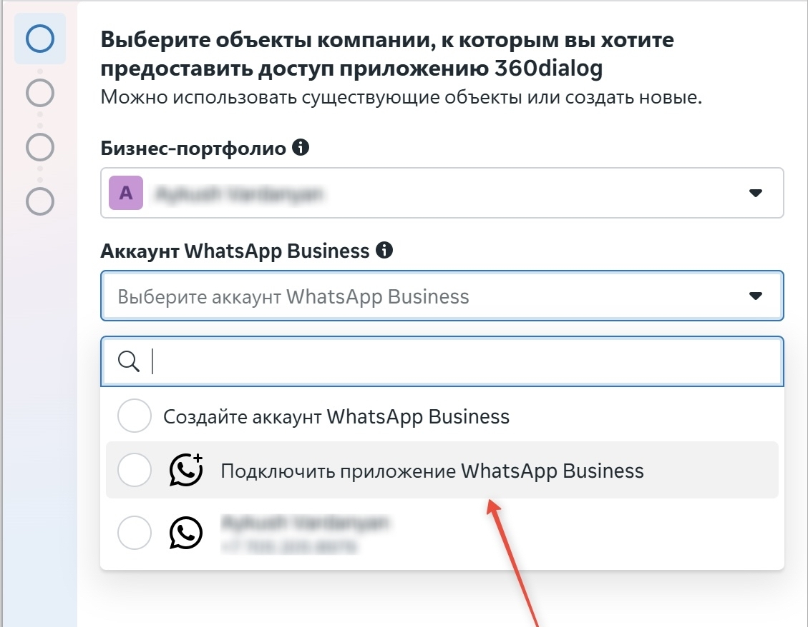
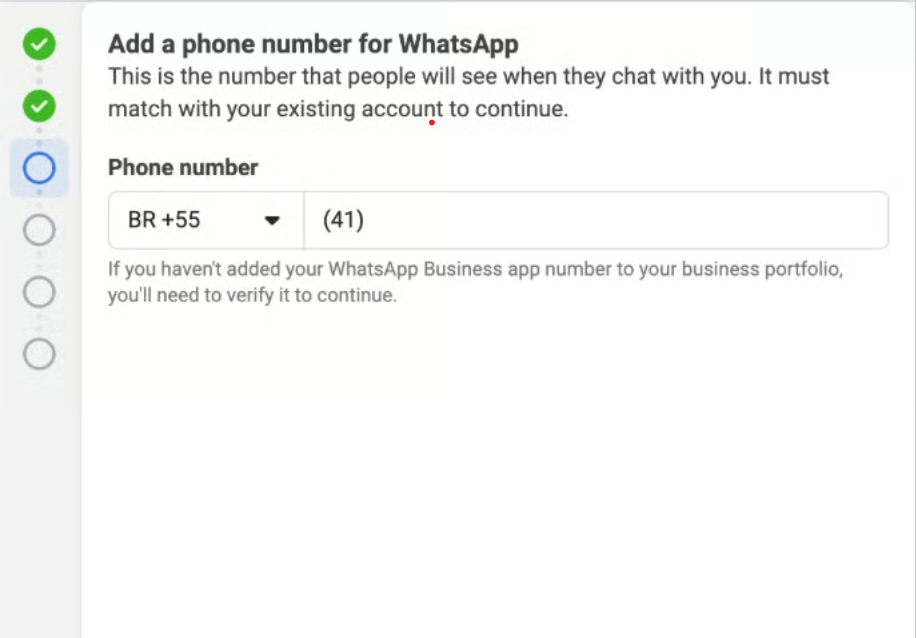
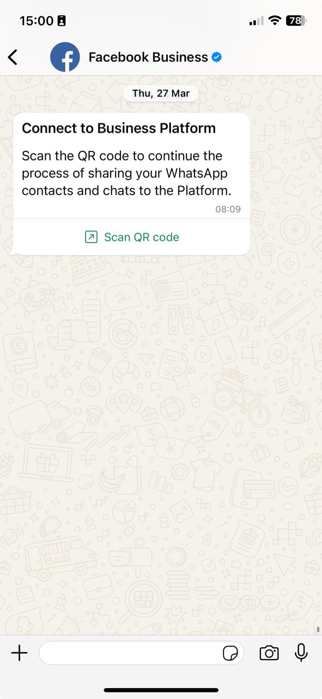
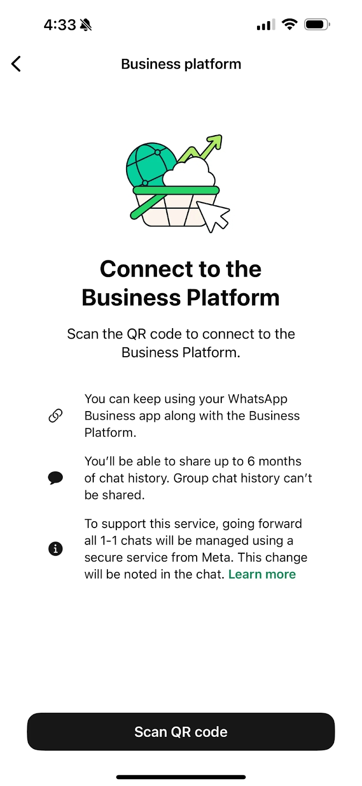

You can now connect a number to WhatsApp Cloud API even if it is already linked to the WhatsApp Business app.

**Coexistence** is a mode where your phone number stays active in the WhatsApp Business mobile app while also being connected to the 1MSG.

**Main benefit:** If a teammate writes to a customer directly from the phone (from the app), that message is delivered to your webhook immediately as a normal outbound message from the business. Your system always knows what is being discussed, even when conversations happen “in the field” from a mobile device.

> [!NOTE]
> Only this scenario is supported: **WhatsApp Business App → API (Coexistence)**.\
> You cannot connect a WABA number *to* the WhatsApp Business App the other way around.

## Capabilities and advantages

* **Full sync:** Outbound messages from the app appear in your integration.
* **Flexible workflow:** Managers can reply on the go from the phone, while bulk sends and chatbots run through the API.
* **Single history:** All threads are stored in your database without gaps.

## Requirements and important notes

Coexistence comes with rules you should follow for stable operation:

1. **Number “seasoning”:** The phone number must have been active in WhatsApp Business for **at least 7 days** before you enable this mode.
2. **Account choice:** During setup, pick the correct **WhatsApp Business Account (WABA)** right away.
3. Open **WhatsApp Business at least once every 14 days**, or the connection may drop.
4. **Up-to-date app:** Install the latest **WhatsApp Business** on a phone **with a camera** (needed to scan the QR code when connecting).

## WhatsApp Business App limitations in Coexistence

After Coexistence is enabled, the app still works, but some features are restricted or behave differently.

**Broadcast lists.** You cannot create new broadcast lists. Old lists become view-only. Mass messaging is only possible via the API (templates).

**Disabled message types.** The following are unavailable:

* Disappearing messages
* View-once messages
* Live location

**Edit and delete limits.** Editing or deleting messages in the app does **not** remove or update them in the WABA API.

**Device limits.**

* All **linked devices** are reset when you connect; you must sign in again.
* Coexistence works only with **WhatsApp Business**, not the personal WhatsApp app.
* Messages from unsupported setups may not reach the API.

## Business Manager and WABA (Meta) limitations

**Business Manager (Meta).** After connection, you **cannot** change Business Manager. The phone number must belong to the company that will send messages. Adding people who are not from your company may lead to **Business Manager** restrictions.

**24-hour customer care window.** The 24-hour window applies to messages sent via **Cloud API**. Messages sent from the **WhatsApp Business app** do **not** follow that window for Cloud API: they do **not** open or extend Cloud API conversation windows and do **not** affect Cloud API pricing for that window.

**Pricing.** After connecting to Cloud API, messages sent by the company through the **WhatsApp Business app** remain **free**; messages sent through the **API** are charged according to **Cloud API / WABA** rules.

* App: not billed
* Cloud API: billed per WABA rules

**Green badge (Official Business Account).** You **cannot** obtain OBA status (the verified badge) in Coexistence mode.

**Regional limits.** The feature is not available everywhere. The number must not be in Meta-restricted regions (the list is updated by Meta), including:

* Nigeria
* South Africa

## How to connect via Embedded Signup

Connection is built into the 1MSG UI and takes a few minutes.

1. **Start Embedded Signup.** Use the standard flow and choose:
2. **Connect the WhatsApp Business app.** Continue with **“Connect existing WhatsApp Business app”**

And enter the phone number again, and complete verification.

3. **Open WhatsApp Business on the phone** and follow in-app steps:

* A new WhatsApp message may ask you to scan a QR code.

* Open it and scan the QR code shown on screen.

4. **Confirm migration and history sync.** Follow the prompts. Tap **“Scan QR code”** and choose **not** to sync message history and contacts (if you need historical sync, contact support).

5. **Finish Embedded Signup.** Confirm or edit your WhatsApp Business Account details.

After completion, the number is ready on WhatsApp Business Platform (Cloud API). Webhooks will log events and become available.

## How to disconnect from WABA

Disable Coexistence in **WhatsApp Business** settings.

### Steps

1. Open **WhatsApp Business**
2. Go to **Settings**
3. Open **Account**
4. Select **Business Platform**
5. Tap **Disconnect**

### What happens after disconnect

* WABA API is **disabled**
* The app keeps working as normal WhatsApp Business
* The webhook **stops** receiving events
* Integrations (CRM, bots, etc.) **stop** working
