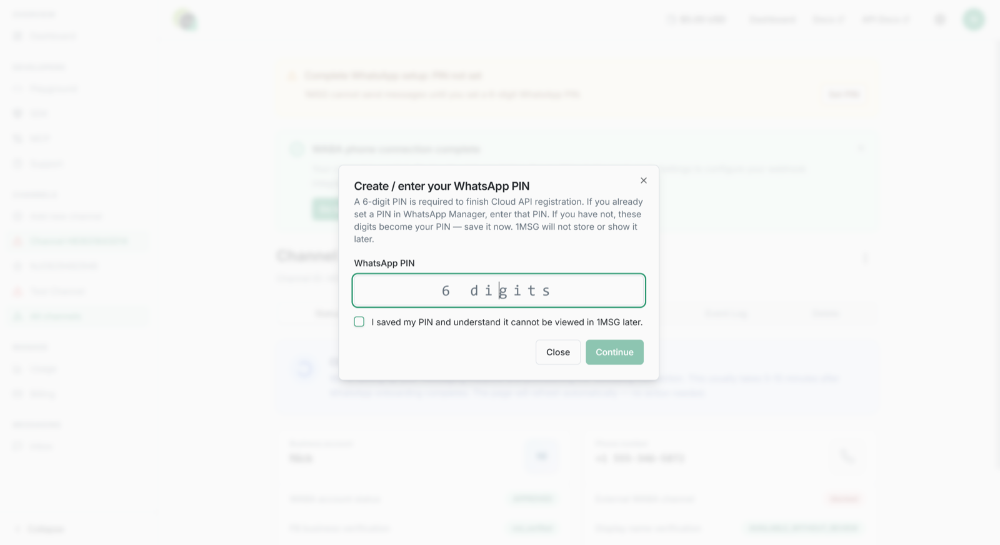

This guide is for the "Bring your own WABA" plan: you connect a WhatsApp Business number that you already manage (or will create) in Meta, and use all 1MSG features included.

> [!NOTE]
> **When to choose Bring your own WABA (BYOW)**
>
> 1. You already have a WABA in Meta Business Manager, or you want to create one under **your** Meta account.
> 2. Messaging usage must be billed **by Meta**, not by 1MSG.
>
> ⚠️**Important:** You need to add a payment method to your Business Portfolio. Otherwise, you won’t be able to send messages.

## What you need

* **Your personal Facebook page** — you create Meta Business and WhatsApp Business accounts from it.
* **Your Meta Business account.** Create it on the [Facebook Business page](https://business.facebook.com/) or use an existing one.
* **A payment method to your Business Portfolio** —  add a valid payment method to your Meta Business Portfolio. We recommend doing this **before connecting your number and creating your WABA** to avoid issues during the setup process.
* **The phone number** you want to attach to WABA.

> [!NOTE]
> To add a payment method, open your **Meta Business Portfolio → Settings → Billing & payments → Payment methods**

How to fill in company information in Meta Business Manager

After you create the accounts, open Meta Business. On the first portfolio you should see **Create a business portfolio** — click it.

Go to **Business Settings** (lower-left menu) → **Business Info** → **Edit**.

Required fields:

* **Company Name** — must match the legal name on your registration documents.
* **Company Website** — the site footer must show legal details and a phone number registered to the company.
* **Company Email Address** — website domain and email domain must match (for example `example.com` and `sales@example.com`).
* **Country, Address, Postal Code, City** — must match the company’s legal address. Meta verification later will ask for documents for this address.
* **Company Phone Number** — may be the same as the WABA number or different. Meta may ask for proof. Show this number in the header or footer of your website.

## What you will do (overview)

1. Sign up on 1msg.io, choose **Bring your own WABA**, start the plan at **$0** (one free month, no auto-renew).
2. Authorize your Facebook account.
3. Create or select Meta Business and WhatsApp Business accounts.
4. Verify the phone number.
5. Before the free month ends, open Stripe and **continue** the subscription — otherwise the channel stops.

You do **not** need to verify the business with Meta at this stage. You can do it later to unlock more options for the number.

## Step 1. Start in 1msg.io — plan and $0 checkout

After registration choose **Bring your own WABA** and click **30-day free trial**.

**Payment conditions:**

* **First month.** The first month is **$0**. You still add a card. Nothing is charged now.
* **Length**. One month from the checkout date.
* **Recurring**. Subscription to **end** when the free month is over. The next month is not charged unless you continue the plan.
* **After the free month.** The monthly (or yearly) price shown on the card. It does not start by itself. If you do nothing, the channel **stops** on the end date.

More about [Subscriptions](../../platform/billing/subscription-plans.md#own-waba-subscription-terms) plans BYOW.

Then:

1. Click **Start subscription for $0**.
2. Choose the plan and click **Connect for $0**.
3. After the $0 payment succeeds, click **Connect WABA** and continue with Meta embedded signup

## Step 2. Authorize Facebook account

Log in with your Facebook page.

## Step 3. Meta Business and WhatsApp Business accounts

Choose or create Meta Business and WhatsApp Business accounts. Click **Continue** and allow 1MSG to manage your WhatsApp Business account.

Select the Meta Business account you created and enter the WhatsApp Business name.

Create the WhatsApp Business profile: name and category on the next two screens.

Verify the number. You can get the code by SMS or an international call. Click **Send code** and enter it.

When verification succeeds, you see that the number is ready.

## Step 4. Authorize 1MSG

After completing the onboarding process, Meta will redirect you to the channel page in 1MSG and ask you to enter your **WhatsApp PIN**.

* If a PIN has already been set for this number, enter it.
* If you have never set a PIN, create a new one and make sure to save it.

**Do not lose your PIN:** it is used to protect your number with two-step verification and may be required if you need to register the number again.

After entering the PIN, complete the channel setup.

You can find the **API URL** and **JWT token** in **Channel → Settings**.

## Step 5. Use the number

You can send and receive messages:

* [Shared Team Inbox](https://platform.1msg.io/dashboard/inbox)
* [API Docs](https://docs.1msg.io/)

## After you are connected

* **API URL and JWT** — for your app.
* **WABA account status** — Meta policy check. Usually fine unless the business is restricted (alcohol, tobacco, crypto, drugs, and similar).
* **Facebook business verification** — not required for this first onboarding.
* **Phone number** — the number linked to the channel.
* **External WABA** — after Meta receives the account, status goes from `DRAFT` (grey) to `DONE` (green).
* **Display name verification** — WhatsApp accepted the business name; customers see it even if it is not in their contacts.
* **Number registration** — `Running` means the number is live.
