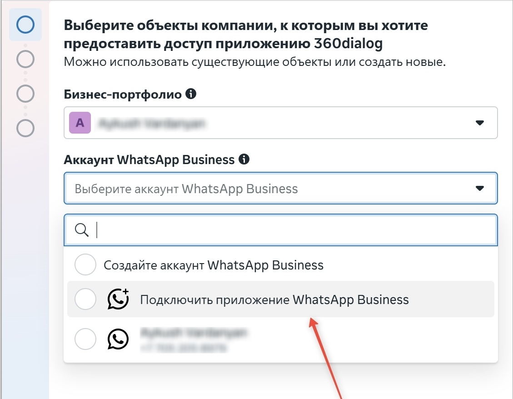
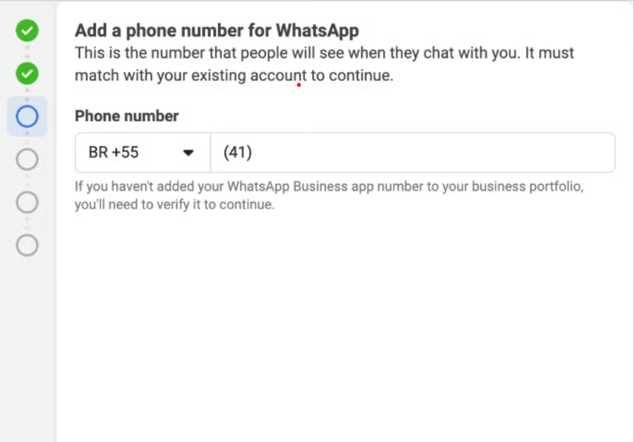
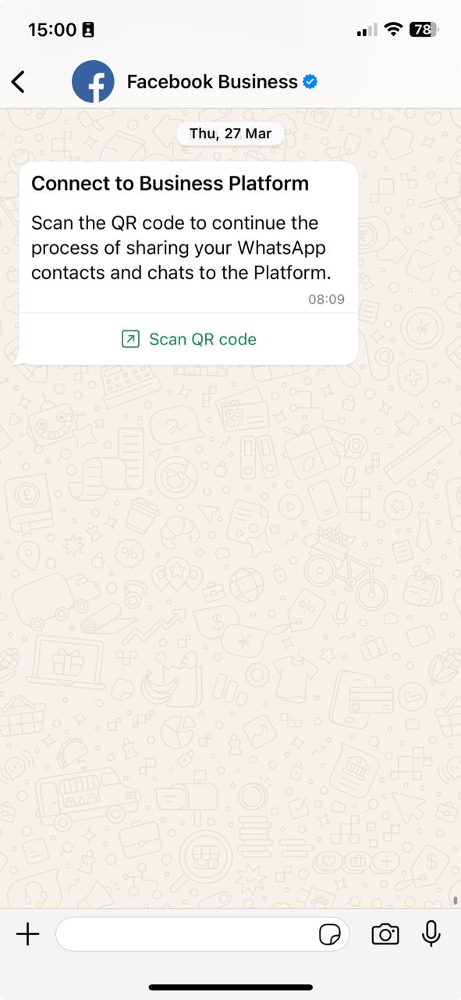
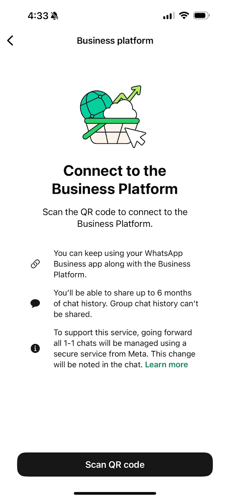

Agora você pode conectar um número à WhatsApp Cloud API mesmo que ele já esteja vinculado ao app WhatsApp Business.

**Coexistence** é um modo em que o número funciona ao mesmo tempo no app WhatsApp Business do celular e na 1MSG.

**Principal vantagem:** se alguém da equipe escreve para um cliente direto do celular (pelo app), essa mensagem chega na hora ao seu webhook como uma mensagem enviada normal da empresa. Assim a integração vê toda a conversa, mesmo quando alguém da equipe responde pelo celular “em campo”.

> [!NOTE]
> Só este cenário é suportado: **app WhatsApp Business → API (Coexistence)**.\
> Não é possível fazer o caminho inverso e conectar um número WABA *ao* app WhatsApp Business.

## Recursos e vantagens

* **Sincronização completa:** as mensagens enviadas pelo app aparecem na sua integração.
* **Trabalho flexível:** os atendentes respondem pelo celular, de onde estiverem, enquanto os envios em massa e os chatbots rodam pela API.
* **Histórico único:** todas as conversas ficam no seu banco de dados, sem lacunas.

## Requisitos e observações importantes

O Coexistence tem regras que você deve seguir para funcionar de forma estável:

1. **“Aquecimento” do número:** o número precisa estar ativo no WhatsApp Business há **pelo menos 7 dias** antes de você ativar este modo.
2. **Escolha da conta:** na configuração, escolha logo a **WhatsApp Business Account (WABA)** correta.
3. Abra o **WhatsApp Business pelo menos uma vez a cada 14 dias**, senão a conexão pode cair.
4. **App atualizado:** instale a versão mais recente do **WhatsApp Business** em um celular **com câmera** (ela é necessária para escanear o QR code na conexão).

## Limitações do app WhatsApp Business no Coexistence

Depois que o Coexistence é ativado, o app continua funcionando, mas alguns recursos ficam restritos ou funcionam de outro jeito.

**Listas de transmissão.** Não é possível criar novas listas de transmissão. As antigas ficam só para visualização. Envios em massa só são possíveis pela API (com templates).

**Tipos de mensagem desativados.** Ficam indisponíveis:

* mensagens temporárias;
* mensagens de visualização única;
* localização em tempo real.

**Limites de edição e exclusão.** Editar ou apagar mensagens no app **não** altera nem remove essas mensagens na WABA API.

**Limites de dispositivos.**

* Todos os **dispositivos conectados** são desconectados quando você faz a conexão; é preciso entrar de novo.
* O Coexistence funciona só com o **WhatsApp Business**, não com o app pessoal do WhatsApp.
* Mensagens de aparelhos e versões não suportados podem não chegar à API.

## Limitações do Business Manager e da WABA (Meta)

**Business Manager (Meta).** Depois da conexão, você **não pode** trocar de Business Manager. O número precisa pertencer à empresa que vai enviar as mensagens. Adicionar pessoas de fora da empresa pode levar a restrições no **Business Manager**.

**Janela de atendimento de 24 horas.** A janela de 24 horas existe só para mensagens pela **Cloud API**. Mensagens do **app WhatsApp Business** **não** abrem, **não** prolongam a janela e **não** mudam o preço das mensagens pela API.

**Preços.** Depois da conexão com a Cloud API, as mensagens que a empresa envia pelo **app WhatsApp Business** continuam **gratuitas**; as mensagens enviadas pela **API** são cobradas pelas regras da **Cloud API / WABA**.

* App: sem cobrança
* Cloud API: cobrado pelas regras da WABA

**Selo verde (Official Business Account).** No modo Coexistence, você **não pode** obter o status OBA (o selo de verificação).

**Limites por região.** O recurso não está disponível em todo lugar. O número não pode estar em regiões restritas pela Meta (a lista é atualizada pela Meta), entre elas:

* Nigéria
* África do Sul

## Como conectar pelo Embedded Signup

A conexão é feita na própria interface da 1MSG e leva poucos minutos.

1. **Inicie o Embedded Signup.** Use o fluxo padrão.
2. **Conecte o app WhatsApp Business.** Continue com **“Connect existing WhatsApp Business app”**.

Digite o número de telefone de novo e conclua a verificação.

3. **Abra o WhatsApp Business no celular** e siga os passos no app:

* Pode chegar uma nova mensagem no WhatsApp pedindo para escanear um QR code.

* Abra a mensagem e escaneie o QR code mostrado na tela.

4. **Confirme a migração e a sincronização do histórico.** Siga as instruções. Toque em **“Scan QR code”** e escolha **não** sincronizar o histórico de mensagens e os contatos (se você precisar do histórico, fale com o suporte).

5. **Conclua o Embedded Signup.** Confirme ou edite os dados da sua WhatsApp Business Account.

Pronto: o número já funciona na WhatsApp Business Platform (Cloud API). Os webhooks ficam disponíveis e passam a receber eventos.

## Como desconectar da WABA

Desative o Coexistence nas configurações do **WhatsApp Business**.

### Passos

1. Abra o **WhatsApp Business**
2. Vá em **Settings** (Configurações)
3. Abra **Account** (Conta)
4. Selecione **Business Platform**
5. Toque em **Disconnect** (Desconectar)

### O que acontece depois de desconectar

* a WABA API é **desativada**
* o app continua funcionando como um WhatsApp Business normal
* o webhook **deixa** de receber eventos
* as integrações (CRM, bots etc.) **param** de funcionar
