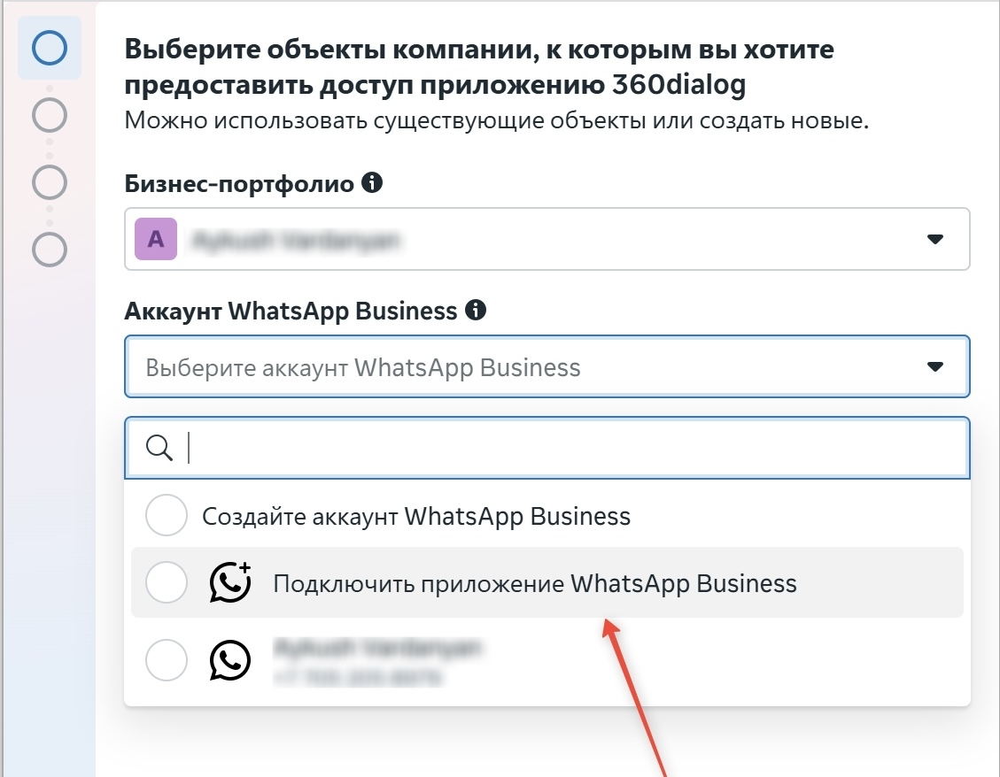
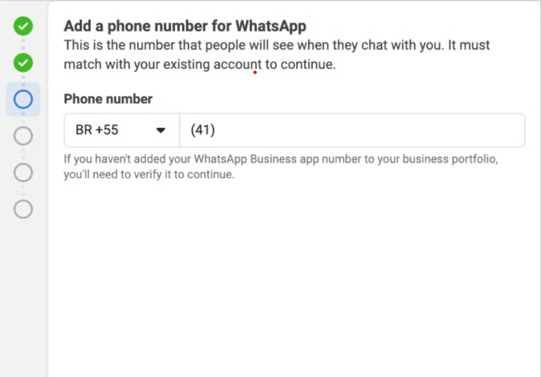
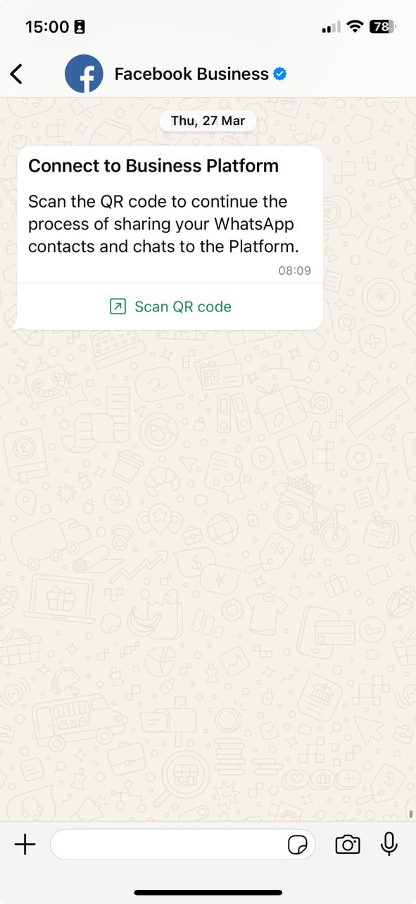
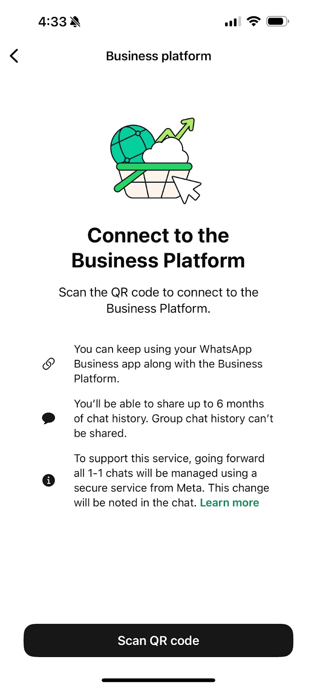

Теперь номер можно подключить к WhatsApp Cloud API, даже если он уже привязан к приложению WhatsApp Business.

**Coexistence** — режим, в котором номер работает и в мобильном приложении WhatsApp Business, и в 1MSG.

**Главный плюс:** если сотрудник пишет клиенту прямо с телефона, из приложения, это сообщение сразу приходит на вебхук как обычное исходящее от бизнеса. Так интеграция видит всю переписку, даже если сотрудник отвечает с телефона «в полях».

> [!NOTE]
> Поддерживается только один сценарий: **приложение WhatsApp Business → API (Coexistence)**.\
> В обратную сторону подключить номер WABA *к* приложению WhatsApp Business нельзя.

## Что даёт режим

* **Полная синхронизация:** исходящие из приложения видны в интеграции.
* **Гибкая работа:** менеджеры отвечают с телефона на ходу, а массовые рассылки и чат-боты работают через API.
* **Единая история:** все переписки хранятся в базе без пропусков.

## Требования и важные моменты

Чтобы Coexistence работал стабильно, соблюдайте несколько правил:

1. **«Прогрев» номера:** номер должен проработать в WhatsApp Business **не меньше 7 дней**, прежде чем включать режим.
2. **Выбор аккаунта:** при настройке сразу выберите правильный **WhatsApp Business Account (WABA)**.
3. Открывайте **WhatsApp Business хотя бы раз в 14 дней**, иначе подключение может слететь.
4. **Свежая версия приложения:** установите последнюю версию **WhatsApp Business** на телефон **с камерой**. Камера нужна, чтобы при подключении отсканировать QR-код.

## Ограничения приложения WhatsApp Business в Coexistence

После включения Coexistence приложение продолжает работать, но часть функций ограничена или работает иначе.

**Списки рассылки.** Новые списки рассылки создать нельзя. Старые остаются только для просмотра. Рассылать можно только через API, шаблонами.

**Отключённые типы сообщений.** Недоступны:

* исчезающие сообщения;
* сообщения для однократного просмотра;
* трансляция геопозиции.

**Правка и удаление.** Если отредактировать или удалить сообщение в приложении, в WABA API оно **не** изменится и **не** удалится.

**Устройства.**

* При подключении все **связанные устройства** отключаются, войти на них нужно заново.
* Coexistence работает только с **WhatsApp Business**, с обычным WhatsApp — нет.
* Сообщения с неподдерживаемых устройств и версий могут не дойти до API.

## Ограничения Business Manager и WABA (Meta)

**Business Manager (Meta).** После подключения сменить Business Manager **нельзя**. Номер должен принадлежать компании, которая будет отправлять сообщения. Если добавить в **Business Manager** людей не из компании, Meta может его ограничить.

**Окно 24 часа.** Окно 24 часа есть только у сообщений через **Cloud API**. Сообщения из **приложения WhatsApp Business** его **не** открывают, **не** продлевают и **не** меняют цену сообщений через API.

**Цены.** После подключения к Cloud API сообщения компании из **приложения WhatsApp Business** остаются **бесплатными**. Сообщения через **API** оплачиваются по правилам **Cloud API / WABA**.

* Приложение: бесплатно
* Cloud API: по правилам WABA

**Зеленая галочка (Official Business Account).** В режиме Coexistence статус OBA, то есть зеленую галочку, получить **нельзя**.

**Регионы.** Функция доступна не везде. Номер не должен быть из регионов, где Meta её ограничивает (список ведёт Meta). Среди них:

* Нигерия
* ЮАР

## Как подключить через Embedded Signup

Подключение встроено в интерфейс 1MSG и занимает несколько минут.

1. **Запустите Embedded Signup.** Так же, как при обычном подключении.
2. **Подключите приложение WhatsApp Business.** Выберите **«Connect existing WhatsApp Business app»**.

Затем снова введите номер телефона и пройдите подтверждение.

3. **Откройте WhatsApp Business на телефоне** и пройдите шаги в приложении:

* Может прийти новое сообщение WhatsApp с просьбой отсканировать QR-код.

* Откройте его и отсканируйте QR-код с экрана.

4. **Подтвердите перенос и синхронизацию истории.** Следуйте подсказкам. Нажмите **«Scan QR code»** и откажитесь от синхронизации истории сообщений и контактов. Если история нужна, напишите в поддержку.

5. **Завершите Embedded Signup.** Подтвердите или поправьте данные WhatsApp Business Account.

Готово: номер работает на WhatsApp Business Platform (Cloud API). Вебхуки станут доступны и начнут получать события.

## Как отключиться от WABA

Coexistence отключается в настройках **WhatsApp Business**.

### По шагам

1. Откройте **WhatsApp Business**
2. Перейдите в **Settings** (Настройки)
3. Откройте **Account** (Аккаунт)
4. Выберите **Business Platform**
5. Нажмите **Disconnect** (Отключить)

### Что будет после отключения

* WABA API **отключится**
* Приложение продолжит работать как обычный WhatsApp Business
* Вебхук **перестанет** получать события
* Интеграции (CRM, боты и т. д.) **перестанут** работать
