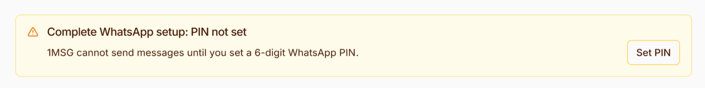

## The number is not linked to the WhatsApp account

The WhatsApp channel is blocked by Meta.

Complete the two steps below, in this order.

**1. Verify the number again in WhatsApp Manager**

The number is not verified right now, so this step is required.

1. Open [WhatsApp Manager](https://business.facebook.com/wa/manage/home/) as the Facebook user who manages the matching WhatsApp Business account.
2. Open the phone numbers section and select the number.
3. Request a new verification code by SMS or voice call and enter it. You must be able to receive an SMS or a call on this number.
4. Wait until the number shows as verified. If the display name is already approved, you do not need to change it.

**2. Set the WhatsApp PIN in 1MSG**

1. Open [platform.1msg.io](https://platform.1msg.io/) and sign in.
2. Open the channel.
3. At the top of the screen you will see the banner **Complete WhatsApp setup: PIN not set**. Click **Set PIN**.

   
4. Enter a 6-digit PIN. If a PIN was already created in WhatsApp Manager, enter the same PIN. If no PIN exists yet, the digits you enter become your PIN. Save it. 1MSG does not store the PIN and cannot show it later.
5. Confirm that the PIN is saved, then click **Continue**.

After both steps, refresh the channel **Status** page. **External WABA channel** should no longer show as **blocked**.

If anything is unclear or you run into a problem, [contact support](../../platform/support.md) and attach screenshots — we will help you sort it out.

## There is an error with the payment method. This will block business-initiated conversations

`There is an error with the payment method` means that Meta cannot charge for WhatsApp messages. Templates and the first message to a customer will not be sent. Replies in an already-open conversation may still be sent.

The payment card must be added in Meta. Your 1MSG subscription does not cover these charges.

**Where to go**

Log in to Facebook using the account that manages this WhatsApp account.

1. Open [Meta Business Suite](https://business.facebook.com/) → Settings.
2. Select the business that owns this WhatsApp account in the top-left corner.
3. Go to Billing & payments → Accounts → select the account for this channel → Add payment method.
4. Add a Visa or Mastercard and save it. If Meta asks for business details, fill them in.

Alternatively, go to WhatsApp Manager → Settings → WhatsApp accounts → select the account → Payment settings → Add payment method.

If a card is already added to your business but is not linked to WhatsApp, go to WhatsApp accounts → select the account → Settings → Payment settings → select the card → Make primary.

You need payment permissions to do this. The account owner has these permissions.

**What to do in 1MSG**

Open the channel on [platform.1msg.io](https://platform.1msg.io/). The banner disappears once Meta accepts the card — usually within a few minutes.

If the banner is still there after an hour, contact [support](../../platform/support.md) and attach screenshots of the banner and the payment screen in Meta.
