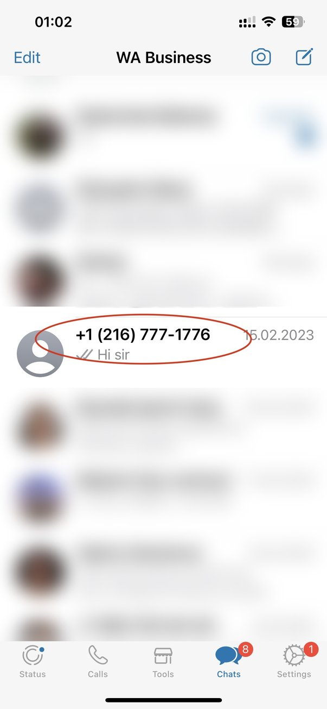
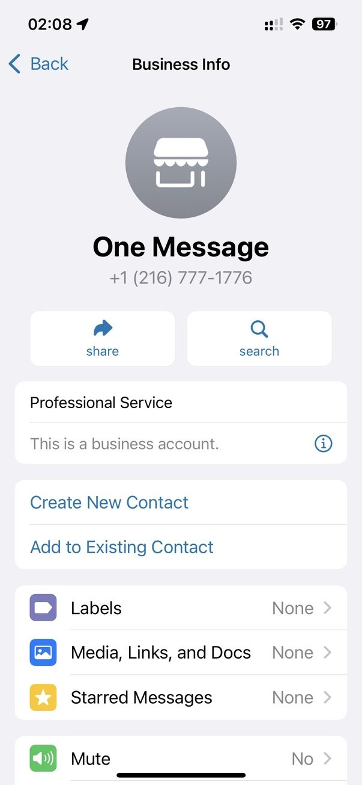
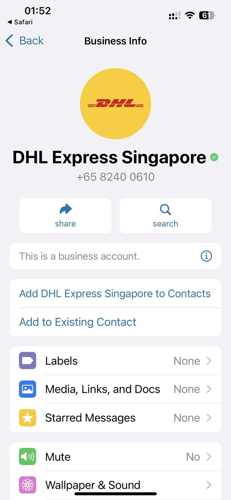
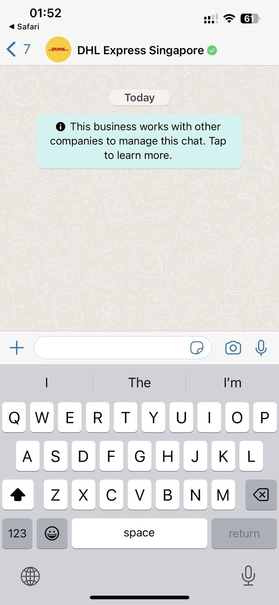
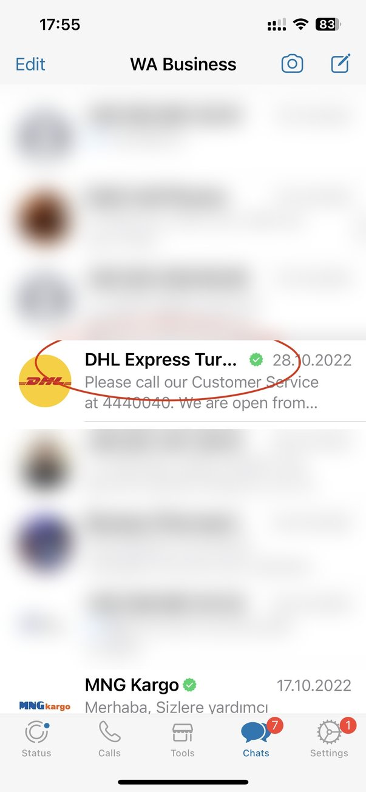
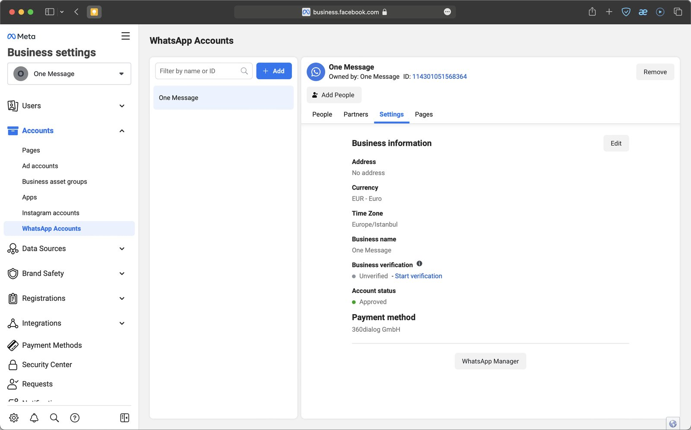
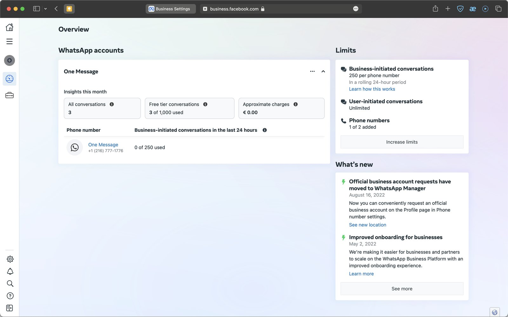
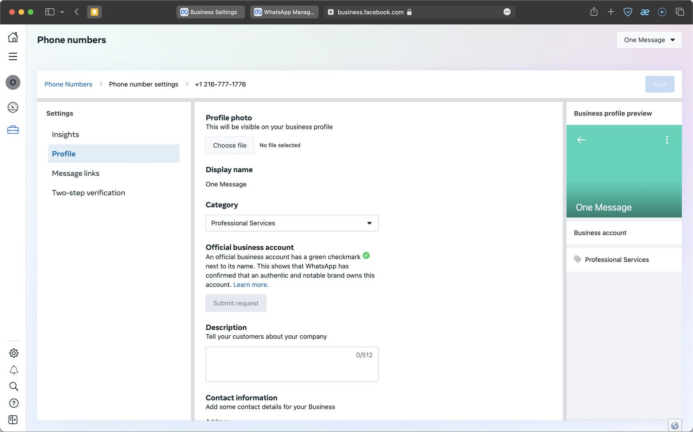

WABA has a number of attractive advantages for businesses, and one of them is the displayed business name along with the green verification tag. What does it provide?

* **Confirmation of recognition.** The customer understands that they are dealing with a respected and well-known brand.
* **Confidence from customers.** Official Business Account status implies a thorough verification of the company by Meta.
* More confidence that the number **won't be blocked** because of user complaints.

## The difference between a business account and an official business account (OBA)

It is easy to confuse the two concepts because of the similar name. A verified account is also official in nature, but the term OBA refers to companies that meet certain, specific criteria. OBA is marked with a green checkmark next to the name of the business.

### "Usual" business account (non-OBA)

In the dialogs list, such a business account is shown as a phone number (if it is not saved in the phonebook on the customer's device). But the name of the business is displayed in contact view above the number, as in the screenshots below:

### Official Business Account (OBA)

Unlike a "regular" business account, an official business account gets a green checkmark on its profile, and the company name appears in the chat list, chat screens and contact view instead of the phone number, even if the user has not added the company to their address book:

## Who can get the OBA checkmark?

To receive an OBA tag, a company must meet a number of requirements:

* Compliance with the WhatsApp commercial and business [policies](https://business.whatsapp.com/policy);
* Pass the Displayed Business name verification in WABA;
* Obtain verified business account status — be verified by Meta Business. This is required in any case, even if your company is fairly well-known;
* Your Meta Business account must be protected by two-factor authentication;
* A certain trust rating for the number (we'll cover this in a separate article);
* A recognized, visible brand that is mentioned in media and searched online. Paid articles or resource directories are not considered as criteria;
* OBA approval does not mean that other phone numbers and brand names associated with the parent will also be approved. For such cases, we recommend showing the connection in the name of the business, such as "\[NewBrandName] by \[ParentBrandName]".

### What if the application is denied?

If your request is rejected, it means that Meta staff did not find evidence of the notoriety and recognition of your business. Unfortunately, it is currently impossible to appeal such decisions. In this case, you might develop your media presence and reapply after 30 days.

## Preliminary steps

### Business verification

Your business must go through a verification procedure: Meta determines how "real" and trustworthy you are.

### Connection to the WhatsApp Business API

Refer to our description of the onboarding process.

* [Connection WABA from 1MSG](./waba-from-1msg.md)

### Displayed Business name confirmation

This is the displayed company name that is visible to the customer, even if your company number is not listed in their phonebook. There are a number of requirements for the name, and this is an important point, because there have been precedents when a business was not given the green checkmark because of violations of the business name requirements.

**Please note:** when your number receives OBA status, it is tied to the business display name. Meta looks at the business name in terms of recognition. If you change it after OBA status is approved, the approval process will need to go through again. This name must be consistent with what your business is known by in the media, so if required, we recommend correcting it in advance — otherwise you may need to make an additional appeal to Meta.

### Two-factor authentication in Meta Business Account

Refer to [Security Center](https://business.facebook.com/settings/security) in Meta Business Manager.

## OBA application process

You can make a request directly from WhatsApp Manager. Go to your [Meta Business Account settings](https://business.facebook.com/settings/whatsapp-business-accounts/) → "WhatsApp Accounts" → select the account → click the "Settings" tab and then the WhatsApp Manager button.

Select a phone number:

And fill out all the needed information:

Click Submit Request and fill out the required information.

You can provide up to five supporting links to prove that your business is known. Choose them carefully, because if your request is rejected, you will not be able to submit another one for up to 30 days.

Keep these requirements in mind before submitting your request to increase your chances of approval:

* Clear information on your site (about products and services, mention of your display name);
* Good traffic to your site plays a positive role;
* Your display name must match your website;
* Have at least 3 links to outside media from newspapers, magazines, etc. Do not use links from your own website;
* It helps if a search engine returns not only the website address but also articles on third-party resources when asked about the company;
* Having a popular Facebook page can help you prove the popularity of your business.
