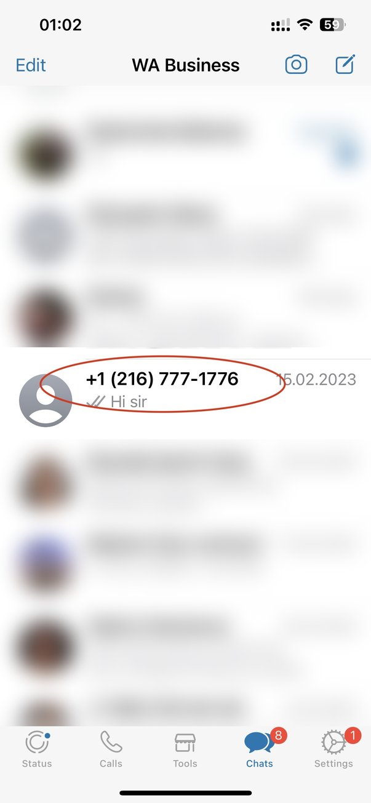
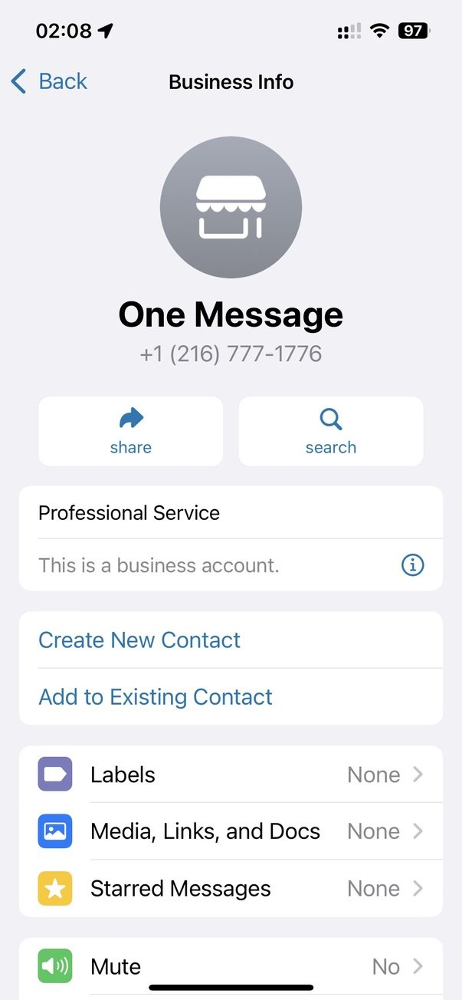
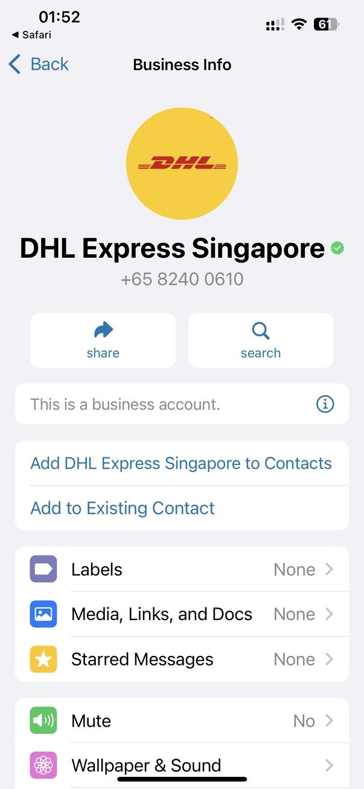
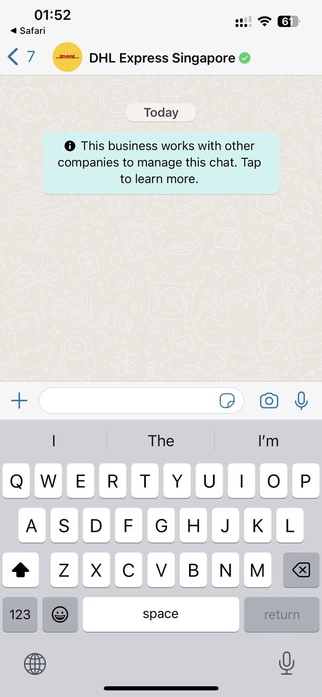
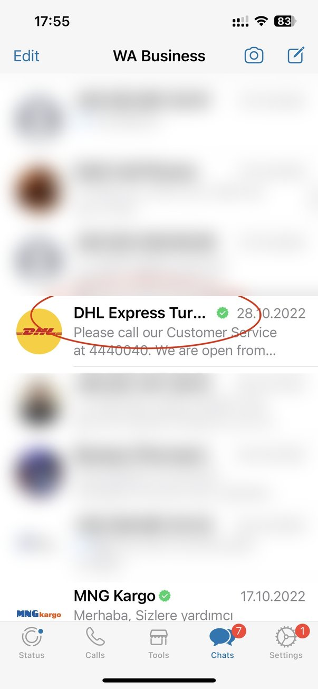
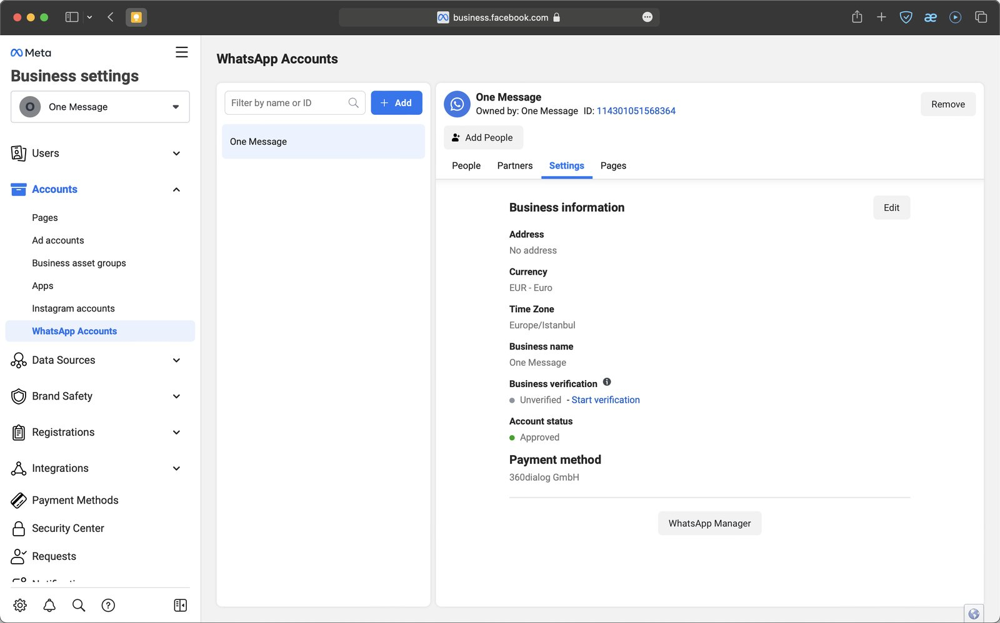
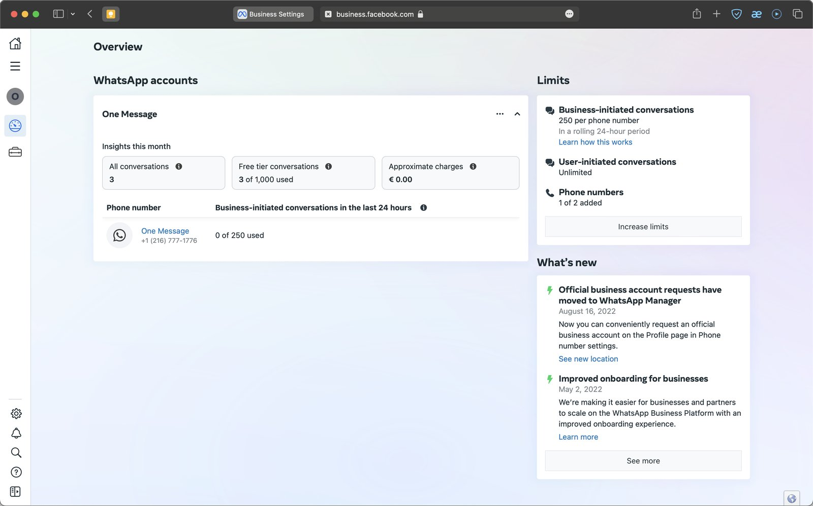
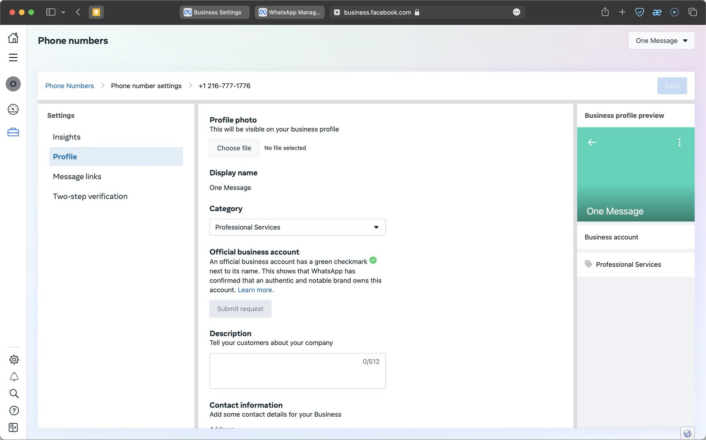

A WABA traz várias vantagens para as empresas, e uma delas é exibir o nome da empresa com o selo verde de verificação. O que isso oferece?

* **Reconhecimento da marca.** O cliente entende que está falando com uma marca conhecida e respeitada.
* **Confiança dos clientes.** O status de Official Business Account significa que a Meta verificou a empresa com cuidado.
* Mais segurança de que o número **não será bloqueado** por denúncias de usuários.

## Diferença entre conta comercial e conta comercial oficial (OBA)

É fácil confundir os dois conceitos porque os nomes são parecidos. Uma conta verificada também é oficial, mas o termo OBA se refere a empresas que atendem a critérios específicos. A OBA tem um selo verde ao lado do nome da empresa.

### Conta comercial “comum” (não OBA)

Na lista de conversas, essa conta comercial aparece como número de telefone (se ele não estiver salvo na agenda do cliente). Mas o nome da empresa aparece nos dados do contato, acima do número, como nas capturas de tela abaixo:

### Conta comercial oficial (OBA)

Diferente de uma conta comercial “comum”, a conta comercial oficial ganha um selo verde no perfil, e o nome da empresa aparece na lista de conversas, na tela da conversa e nos dados do contato no lugar do número, mesmo que o usuário não tenha salvado a empresa na agenda:

## Quem pode obter o selo OBA?

Para receber o selo OBA, a empresa precisa atender a vários requisitos:

* Cumprir as [políticas](https://business.whatsapp.com/policy) comerciais do WhatsApp;
* Passar pela verificação do nome de exibição da empresa na WABA;
* Ter o status de conta comercial verificada, ou seja, passar pela verificação da Meta Business. Isso é obrigatório em qualquer caso, mesmo que a sua empresa seja bem conhecida;
* A conta da Meta Business precisa estar protegida com autenticação de dois fatores;
* Ter uma certa classificação de confiança do número (vamos falar disso em outro artigo);
* Ser uma marca reconhecida e visível, citada na mídia e buscada na internet. Artigos pagos e diretórios de sites não contam;
* A aprovação da OBA não significa que outros números e marcas ligados à empresa principal também serão aprovados. Nesses casos, recomendamos mostrar essa ligação no nome da empresa, por exemplo “\[NovaMarca] by \[MarcaPrincipal]”.

### E se o pedido for recusado?

Se o pedido for recusado, a equipe da Meta não encontrou provas de que a sua empresa é conhecida e reconhecida. Hoje não é possível recorrer dessa decisão. Nesse caso, você pode aumentar a presença da empresa na mídia e fazer um novo pedido depois de 30 dias.

## Passos preliminares

### Verificação da empresa

A sua empresa precisa passar por uma verificação: a Meta avalia se a empresa é “real” e confiável.

### Conexão à WhatsApp Business API

Veja como funciona a conexão:

* [Conexão WABA da 1MSG](./waba-from-1msg.pt.md)

### Confirmação do nome de exibição

É o nome da empresa que o cliente vê, mesmo que o número da sua empresa não esteja na agenda dele. O nome precisa cumprir vários requisitos, e isso é importante: já houve casos em que a empresa não recebeu o selo verde porque o nome violava essas regras.

**Atenção:** quando o número recebe o status OBA, ele fica vinculado ao nome de exibição da empresa. A Meta avalia o nome pelo reconhecimento. Se você mudar o nome depois que a OBA for aprovada, será preciso passar pela aprovação de novo. O nome precisa ser o mesmo pelo qual a empresa é conhecida na mídia. Se for preciso, corrija o nome antes, senão talvez você tenha que fazer um novo pedido à Meta.

### Autenticação de dois fatores na Meta Business Account

Use o [Security Center](https://business.facebook.com/settings/security) no Meta Business Manager.

## Como fazer o pedido de OBA

O pedido é feito direto no WhatsApp Manager. Abra as [configurações da Meta Business Account](https://business.facebook.com/settings/whatsapp-business-accounts/) → “WhatsApp Accounts” → selecione a conta → clique na aba “Settings” e depois no botão WhatsApp Manager.

Selecione um número de telefone:

E preencha todas as informações necessárias:

Clique em Submit Request e preencha as informações pedidas.

Você pode enviar até cinco links para provar que a sua empresa é conhecida. Escolha com cuidado: se o pedido for recusado, você não poderá enviar outro por até 30 dias.

Antes de enviar o pedido, lembre destes requisitos para aumentar as chances de aprovação:

* Informações claras no seu site (sobre produtos e serviços, com o nome de exibição);
* Um bom tráfego no site ajuda;
* O nome de exibição precisa ser o mesmo do site;
* Tenha pelo menos 3 links de mídia externa, como jornais e revistas. Não use links do seu próprio site;
* Ajuda bastante se, ao buscar a empresa, o buscador mostrar não só o site, mas também matérias em outros sites;
* Uma página popular no Facebook pode ajudar a provar que a empresa é conhecida.
