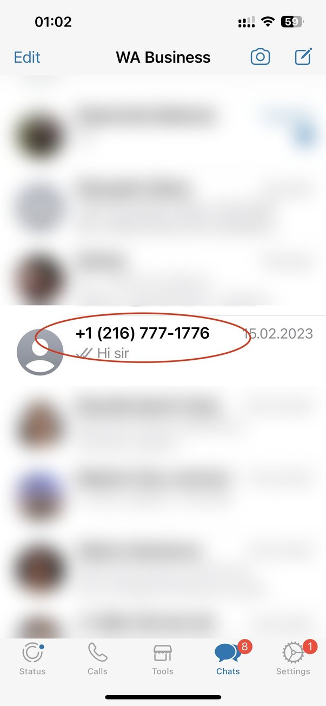
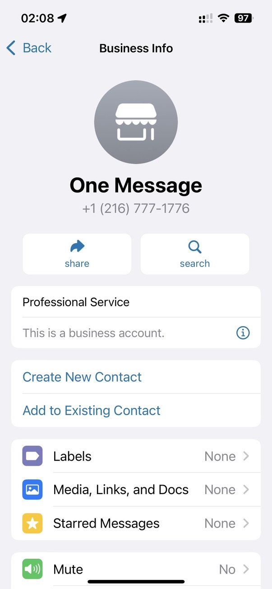
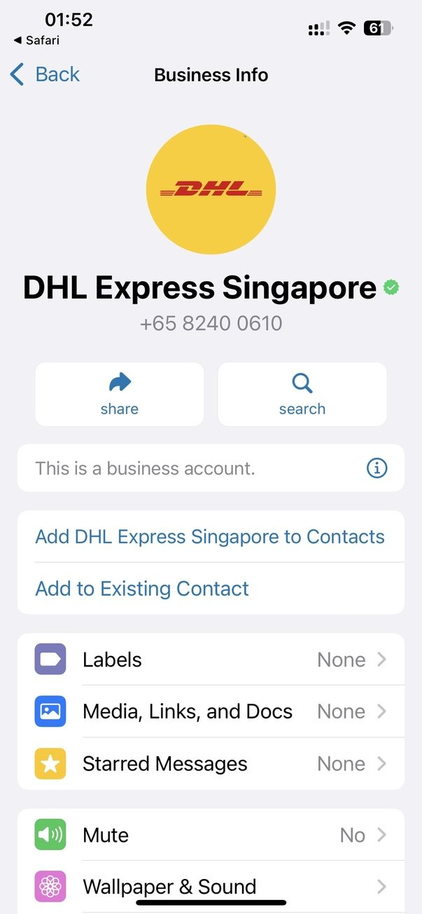
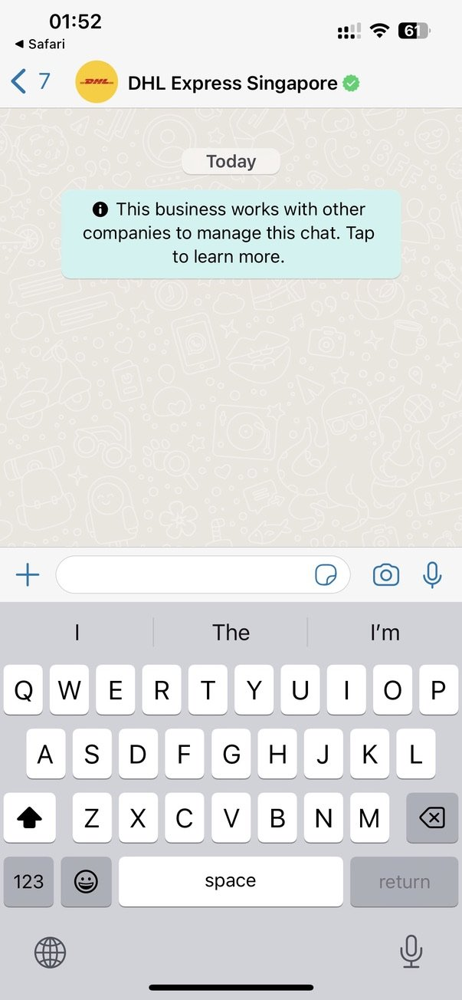
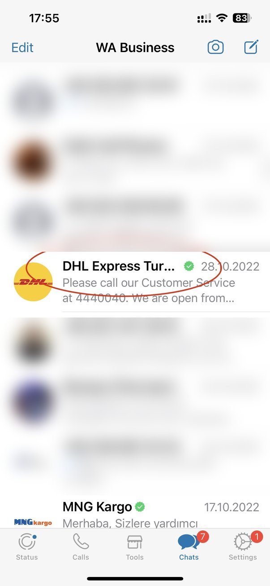
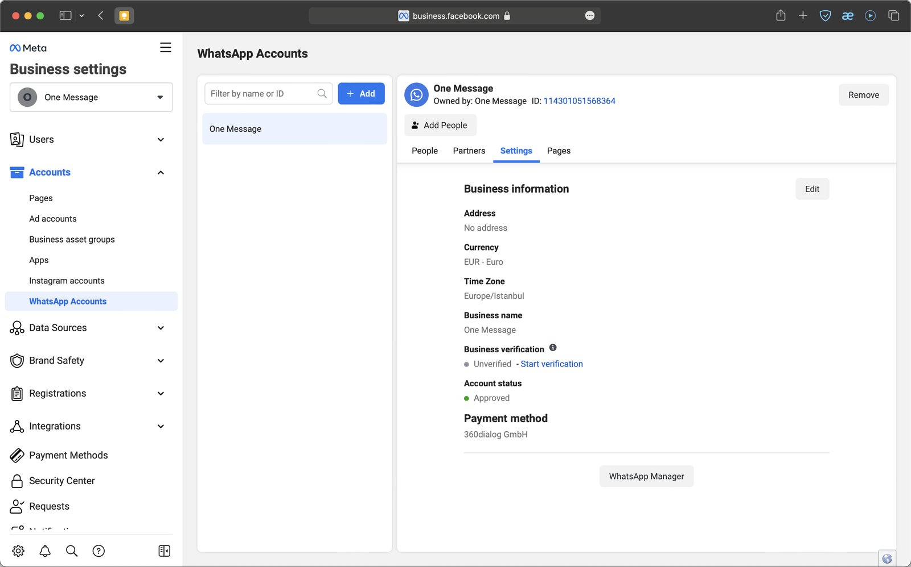
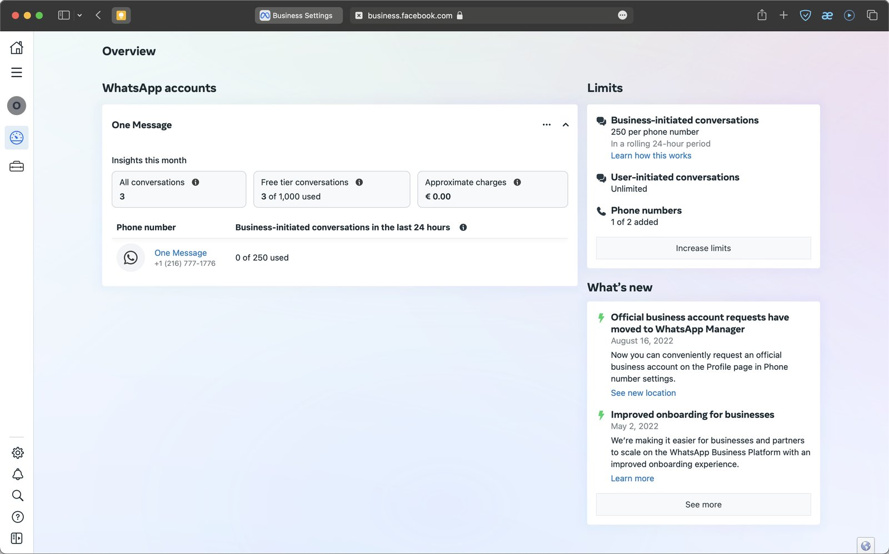
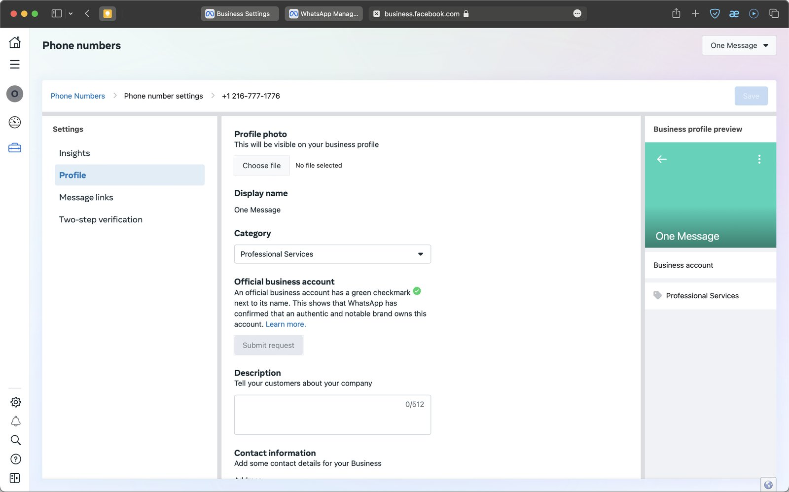

WABA имеет ряд привлекательных преимуществ для бизнеса, и одно из них - отображение названия компании вместе с зеленой галочкой. Что это дает?

* **Подтверждение бренда.** Клиент понимает, что имеет дело с уважаемым и известным брендом.
* **Доверие со стороны клиентов.** Статус Official Business Account подразумевает тщательную проверку компании со стороны Meta.
* Больше уверенности в том, что номер не будет заблокирован из-за жалоб пользователей.

## Разница между бизнес-аккаунтом и официальным бизнес-аккаунтом (OBA)

Эти два понятия легко спутать из-за схожего названия. Верифицированная учетная запись также носит официальный характер, но термин OBA относится к компаниям, которые соответствуют определенным, конкретным критериям. OBA обозначается зеленой галочкой рядом с названием компании.

### «Обычный» бизнес-аккаунт (не OBA)

В списке диалогов такой бизнес-аккаунт будет виден как номер телефона (если он не сохранен в телефонной книге на устройстве клиента). Но название бизнеса отображается в режиме просмотра контакта над номером, как на скриншоте ниже:

### Официальный бизнес-аккаунт (OBA)

В отличие от «обычного» бизнес-аккаунта, официальный бизнес-аккаунт будет отмечен зеленой галочкой в профиле, а название компании будет отображаться в списке чатов, на экранах чатов и при просмотре контактов вместо номера телефона, даже если пользователь не добавил компанию в свою адресную книгу:

## Кто может получить галочку OBA?

Чтобы получить галочку OBA, компания должна соответствовать ряду требований:

* Соблюдение коммерческой и деловой [политики](https://business.whatsapp.com/policy) WhatsApp;
* Пройти проверку отображаемого названия бизнеса в WABA;
* Получить статус верифицированного бизнес-аккаунта - пройти верификацию в Meta Business. Это потребуется в любом случае, даже если ваша компания достаточно известна;
* Ваша учетная запись Meta Business должна быть защищена двухфакторной аутентификацией;
* Определенный рейтинг доверия к номеру (об этом мы расскажем в отдельной статье);
* Узнаваемый, заметный бренд, о котором упоминают в СМИ и ищут в Интернете. Платные статьи или каталоги ресурсов не будут рассматриваться в качестве критериев;
* Одобрение OBA не означает, что другие телефонные номера и названия брендов, связанные с родительским, также будут одобрены. В таких случаях мы рекомендуем указывать такую связь в названии бизнеса, например «{{название суббренда}} на {{примечательное имя}}».

### Что делать, если заявка была отклонена?

Если ваша заявка отклонена, это означает, что сотрудники Meta не нашли доказательств известности и признания вашего бизнеса. К сожалению, в настоящее время обжаловать такие решения невозможно. В этом случае вы можете развивать свое медийное присутствие и повторно подать заявку через 30 дней.

## Подготовительные шаги

### Верификация бизнеса

Ваш бизнес должен пройти процедуру верификации - Meta определяет, насколько вы «реальны» и заслуживаете доверия.

### Подключение к WhatsApp Business API

См. описание процесса подключения.

* [Подключение WABA from 1MSG](./waba-from-1msg.ru.md)

### Подтверждение отображаемого названия компании

Это название компании, которое видно клиенту - даже если номер вашей компании не занесен в его телефонную книгу. К названию предъявляется ряд требований, и это очень важно, поскольку были прецеденты, когда компания не получала зеленый флажок из-за нарушения требований к названию.

**Обратите внимание:** когда ваш номер получает статус OBA, он привязывается к отображаемому имени бизнеса. Meta рассматривает название бизнеса с точки зрения узнаваемости. Если вы измените его после утверждения статуса OBA, процесс утверждения придется проходить заново. Это название должно соответствовать тому, под которым ваш бизнес известен в средствах массовой информации, поэтому при необходимости мы рекомендуем исправить его заранее - в противном случае вам может потребоваться дополнительное обращение в Meta.

### Двухфакторная аутентификация в Meta Business Account

Обратитесь к [Security Center](https://business.facebook.com/settings/security) в Meta Business Manager

## Процесс подачи заявки на OBA

Вы можете сделать запрос непосредственно из WhatsApp Manager. Перейдите в [Meta Business Account settings](https://business.facebook.com/settings/whatsapp-business-accounts/) → «WhatsApp Accounts» → выберите учетную запись → нажмите вкладку «Settings», а затем кнопку WhatsApp Manager.

Выберите номер телефона:

И заполните всю необходимую информацию:

Нажмите кнопку Отправить запрос (Submit Request) и заполните необходимую информацию.

Вы можете предоставить до 5 подтверждающих ссылок, чтобы доказать, что ваш бизнес известен. Выбирайте их тщательно, потому что если ваш запрос будет отклонен, вы не сможете подать новый в течение 30 дней.

Пожалуйста, помните об этих требованиях, чтобы увеличить шансы на одобрение до подачи заявки:

* Понятная и достоверная информация на вашем сайте (о товарах и услугах, упоминание вашего имени).
* Хорошая посещаемость вашего сайта сыграет положительную роль;
* Название бизнеса должно соответствовать вашему сайту;
* Предоставьте как минимум 3 ссылки на внешние СМИ из газет, журналов и т.д. Не используйте ссылки с вашего собственного сайта;
* Будет показательно, если на запрос о компании поисковая система выдаст не только адрес сайта, но и статьи на сторонних ресурсах;
* Наличие популярной страницы в Facebook поможет вам доказать популярность вашего бизнеса.
