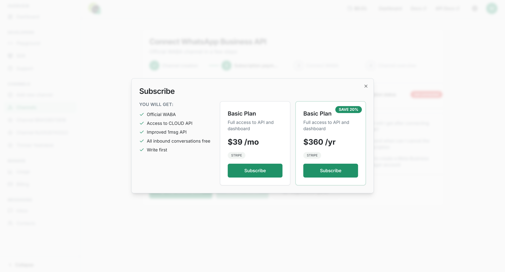
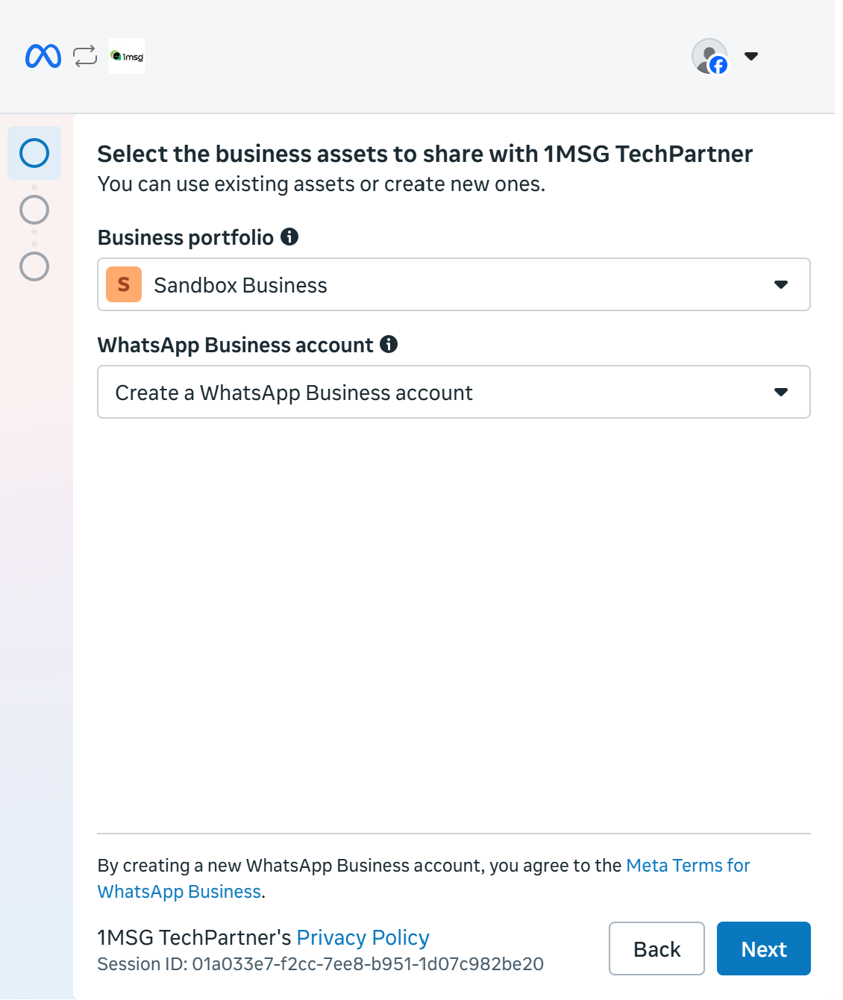
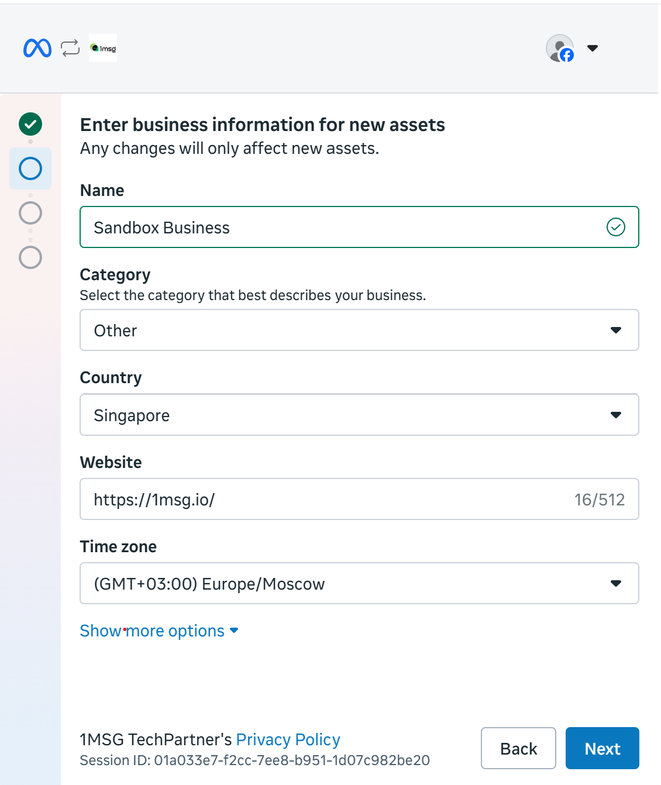
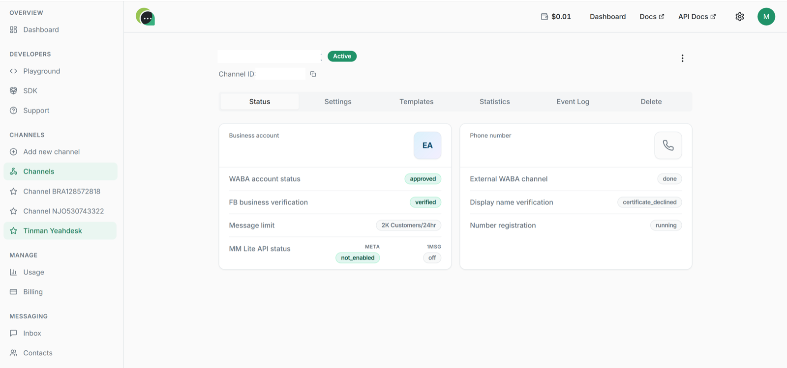
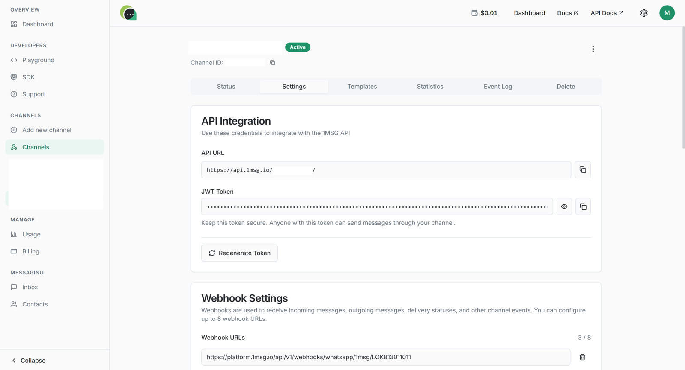

Here’s what you need:

* **Your personal Facebook page** on whose behalf you will create Meta Business and WhatsApp Business accounts.
* **Your Meta Business account.** You can create it on [Facebook Business page](https://business.facebook.com/) or use your existing one.
* **The phone number** which you want to attach to WABA.

How to Fill in Company Information in Meta Business Manager

Once you have created the required accounts, go to Meta Business. Since we assume this is your first time creating a business portfolio, on the start page you should see the “Create a business portfolio” button. Click it.

After logging into your business account, go to “Business Settings” in the lower-left menu. Then select “Business Info” and click the “Edit” button on the page that opens.

Required fields to fill in:

* **Company Name**\
  The company name must match the name specified in your Tax Identification Certificate, Unified State Register of Legal Entities, or Unified State Register of Individual Entrepreneurs.
* **Company Website**\
  Enter your website address. The footer of your website must contain your company’s legal details and a phone number registered to the company.
* **Company Email Address**\
  Your website domain and email domain must match. For example, if your website is example.com, the email address could be <sales@example.com>.
* **Country, Address, Postal Code, City**\
  These details must match the legal address of your company. In the future, for Meta account verification, you will need to provide documents confirming that this address belongs to your company.
* **Company Phone Number**\
  The phone number in Business Manager and the phone number used for WABA may be the same or different. Supporting documents may be required for the phone number specified here. It is also recommended to display this phone number in the header or footer of your website.

## Here’s briefly what you’ll have to do:

1. Sign up to 1msg.io and set up a subscription.
2. Authorize Facebook account.
3. Create or select your Meta Business and WhatsApp Business accounts.
4. Verify your phone number.

At this stage you do not need to verify your business with Meta—you can do it later in order to extend the options of working with your number.

## Step 1. Starting with 1msg.io

Go to your account and click “Add new channel”. Next, you need to subscribe. Annual payment gives you additional 2+ months:

Once your subscription is set up, click the “Connect WABA” button to go through embedded onboarding process.

## Step 2. Authorize Facebook account

Login with your Facebook page:

## Step 3. Meta Business and WhatsApp Business accounts

Now you’re ready to choose or create Meta Business and WhatsApp Business accounts. Click “Get started” and allow to manage your WhatsApp Business account:

[WABA Coexistence](./coexistence.md)

Choose your Meta Business account which you’ve created before, and enter the desired WhatsApp Business name:

Now let's create WhatsApp Business profile. Choose the name and the category in next two pages:

It's time to verify your number. You can get a code by SMS or incoming international call. Choose what works for you, click "Send code" and type it.

After the verification, you'll see the message that confirms your number is ready.

## Step 4. Authorize 1msg

After a successful authorization you'll be redirected to your 1msg.io account. Open your channel, then your new channel's page and you'll see your API URL and JWT token:

## Step 5. Verify your phone number

Now you're ready to go. You can send and get messages and check your number with:

* [Shared Team Inbox](https://platform.1msg.io/dashboard/inbox)
* [API](https://docs.1msg.io/)

## Conclusion

Let's see what we have:

* **API URL and JWT token**, which you can use with your application
* **WABA account status.** The result of your business verification to comply WhatsApp policies. This might not cause you any obstacles if your business is not about something illegal or suspicious (alcohol or tobacco selling, cryptocurrencies, drugs);
* **FB business verification.** Not mandatory for the initial onboarding stage;
* **Phone number.** Here's your phone number which you've linked with the channel;
* **External WABA channel.** When your company's account has been submitted to Meta, the External WhatsApp Business Account (WABA Account) status will change from `DRAFT` (grey) to `DONE` (green);
* **Display name verification.** It means that your business name is accepted by WhatsApp and your customers will see it even it's not in their contact list, like below (One Message is a business name in this case).
* **Number registration.** 'Running' status means that everything is okay.
