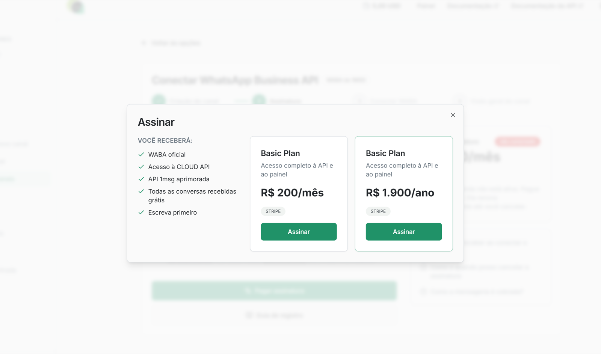

O que você precisa:

* **Sua página pessoal do Facebook**, em nome da qual você vai criar as contas Meta Business e WhatsApp Business.
* **Sua conta Meta Business.** Você pode criá-la na [página do Facebook Business](https://business.facebook.com/) ou usar uma que já exista.
* **O número de telefone** que você quer vincular ao WABA. Veja a nota abaixo:

> [!NOTE]
> Atenção: se o número já foi usado nos apps WhatsApp ou WhatsApp Business, você precisa excluir a conta primeiro. Depois disso, esse número não poderá mais ser usado como um WhatsApp comum — só via WABA. Se quiser usar o número em um messenger no celular, temos o [aplicativo Android](https://play.google.com/store/apps/details?id=app.onemessage.io); o app para iOS está em desenvolvimento.

Como preencher as informações da empresa no Meta Business Manager

Depois de criar as contas necessárias, acesse o Meta Business. Como assumimos que este é o primeiro portfólio comercial, na página inicial você deve ver o botão “Create a business portfolio”. Clique nele.

Depois de entrar na conta comercial, vá em “Business Settings” no menu inferior esquerdo. Em seguida, selecione “Business Info” e clique em “Edit” na página que abrir.

Campos obrigatórios:

* **Company Name**\
  O nome da empresa deve ser o mesmo que consta no CNPJ, no contrato social ou no registro de empresário individual.
* **Company Website**\
  Informe o endereço do site. O rodapé do site deve trazer os dados legais da empresa e um telefone registrado em nome dela.
* **Company Email Address**\
  O domínio do site e o domínio do e-mail devem coincidir. Por exemplo, se o site é example.com, o e-mail pode ser <sales@example.com>.
* **Country, Address, Postal Code, City**\
  Esses dados devem coincidir com o endereço legal da empresa. Mais adiante, na verificação da conta Meta, você vai precisar de documentos que comprovem que esse endereço pertence à empresa.
* **Company Phone Number**\
  O telefone no Business Manager e o telefone usado no WABA podem ser iguais ou diferentes. Para o número informado aqui, podem ser pedidos documentos comprobatórios. Também é recomendável exibir esse telefone no cabeçalho ou no rodapé do seu site.

## Em resumo, o que você vai fazer:

1. Cadastre-se no 1msg.io e ative uma assinatura.
2. Autorize a conta do Facebook.
3. Crie ou selecione as contas Meta Business e WhatsApp Business.
4. Verifique o número de telefone.

Nesta etapa você ainda não precisa verificar a empresa na Meta — isso pode ser feito depois, para ampliar as opções de uso do número.

## Passo 1. Começando no 1msg.io

Entre na sua conta e clique em “Adicionar novo canal”. Em seguida, você precisa assinar. O pagamento anual dá 2+ meses a mais:

Com a assinatura ativa, clique em “Conectar WABA” para seguir o embedded onboarding.

## Passo 2. Autorize a conta do Facebook

Entre com a sua página do Facebook.

## Passo 3. Contas Meta Business e WhatsApp Business

Agora você pode escolher ou criar as contas Meta Business e WhatsApp Business. Clique em “Get started” e permita gerenciar sua conta WhatsApp Business:

Escolha a conta Meta Business que você já criou e informe o nome desejado do WhatsApp Business:

Agora vamos criar o perfil do WhatsApp Business. Escolha o nome e a categoria nas duas páginas seguintes:

É hora de verificar o número. Você pode receber o código por SMS ou por ligação internacional. Escolha o que funcionar melhor, clique em "Send code" e digite o código.

Depois da verificação, você verá a mensagem confirmando que o número está pronto.

## Passo 4. Autorize o 1msg

Após a autorização, você será redirecionado para a sua conta 1msg.io. Abra o canal e, na página do novo canal, você verá a URL da API e o JWT token:

## Passo 5. Use o número

Pronto para começar. Você pode enviar e receber mensagens e conferir o número em:

* [Shared Team Inbox](https://platform.1msg.io/dashboard/inbox)
* [API](https://docs.1msg.io/)

## Conclusão

O que você tem agora:

* **URL da API e JWT token**, para usar no seu aplicativo
* **Status da conta WABA.** O resultado da verificação da empresa em relação às políticas do WhatsApp. Isso costuma não ser um obstáculo se o negócio não for ilegal ou suspeito (venda de álcool ou tabaco, criptomoedas, drogas);
* **Verificação da empresa no Facebook.** Não é obrigatória na etapa inicial de onboarding;
* **Número de telefone.** O número que você vinculou ao canal;
* **Canal WABA externo.** Quando a conta da empresa for enviada à Meta, o status da External WhatsApp Business Account (WABA Account) muda de `DRAFT` (cinza) para `DONE` (verde);
* **Verificação do display name.** Significa que o WhatsApp aceitou o nome da empresa e os clientes vão vê-lo mesmo que não esteja na lista de contatos, como abaixo (neste exemplo, One Message é o nome da empresa).
* **Registro do número.** O status 'Running' significa que está tudo certo.
