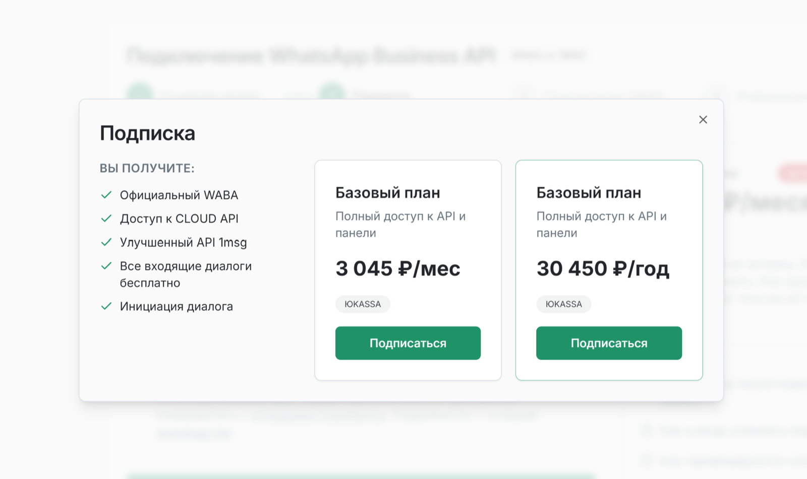

Что вам понадобится:

* **Личная страница Facebook**, от имени которой вы будете создавать аккаунты Meta Business и WhatsApp Business.
* **Аккаунт Meta Business.** Его можно создать на [странице Facebook Business](https://business.facebook.com/) или использовать уже существующий.
* **Номер телефона**, который вы хотите привязать к WABA.

Как заполнить информацию о компании в Meta Business Manager

После создания нужных аккаунтов перейдите в Meta Business. Если вы создаёте бизнес-портфель впервые, на стартовой странице должна быть кнопка “Create a business portfolio”. Нажмите её.

После входа в бизнес-аккаунт откройте “Business Settings” в меню слева внизу. Затем выберите “Business Info” и нажмите “Edit” на открывшейся странице.

Обязательные поля:

* **Company Name**\
  Название компании должно совпадать с названием в свидетельстве о постановке на налоговый учёт, ЕГРЮЛ или ЕГРИП.
* **Company Website**\
  Укажите адрес сайта. В футере сайта должны быть юридические реквизиты компании и телефон, зарегистрированный на компанию.
* **Company Email Address**\
  Домен сайта и домен email должны совпадать. Например, если сайт — example.com, email может быть <sales@example.com>.
* **Country, Address, Postal Code, City**\
  Эти данные должны совпадать с юридическим адресом компании. Позже, для верификации аккаунта Meta, понадобятся документы, подтверждающие, что этот адрес принадлежит компании.
* **Company Phone Number**\
  Телефон в Business Manager и телефон для WABA могут совпадать или различаться. Для номера, указанного здесь, могут потребоваться подтверждающие документы. Также рекомендуется разместить этот номер в шапке или футере сайта.

## Кратко, что нужно сделать:

1. Зарегистрироваться на 1msg.io и оформить подписку.
2. Авторизовать аккаунт Facebook.
3. Создать или выбрать аккаунты Meta Business и WhatsApp Business.
4. Подтвердить номер телефона.

На этом этапе не нужно верифицировать бизнес в Meta — это можно сделать позже, чтобы расширить возможности работы с номером.

## Шаг 1. Начало работы в 1msg.io

Войдите в аккаунт и нажмите “Добавить новый канал”. Далее нужно оформить подписку. При годовой оплате вы получаете дополнительно 2+ месяца:

После оформления подписки нажмите “Подключить WABA”, чтобы пройти подключение WABA.

## Шаг 2. Авторизация аккаунта Facebook

Войдите через страницу Facebook:

## Шаг 3. Аккаунты Meta Business и WhatsApp Business

Теперь можно выбрать или создать аккаунты Meta Business и WhatsApp Business. Нажмите “Continue” и разрешите управление WhatsApp Business account:

Выберите ранее созданный аккаунт Meta Business и введите желаемое имя WhatsApp Business:

Далее создайте профиль WhatsApp Business. На следующих двух страницах выберите имя и категорию:

Пора подтвердить номер. Код можно получить по SMS или входящему международному звонку. Выберите удобный способ, нажмите "Send code" и введите код.

После подтверждения вы увидите сообщение, что номер готов.

## Шаг 4. Авторизация в 1msg

После успешной авторизации вас перенаправит на запущенный канал 1msg.io. На странице нового канала будут API URL и JWT token:

## Шаг 5. Использование номера

Всё готово. Можно отправлять и получать сообщения и проверить номер через:

* [Shared Team Inbox](https://platform.1msg.io/dashboard/inbox)
* [API](https://docs.1msg.io/)

## Итог

Что у вас есть:

* **API URL и JWT token** — для использования в вашем приложении;
* **Статус аккаунта WABA.** Результат проверки бизнеса на соответствие политикам WhatsApp. Обычно это не мешает, если бизнес не связан с чем-то незаконным или подозрительным (продажа алкоголя или табака, криптовалюты, наркотики);
* **Верификация бизнеса в Facebook.** Не обязательна на этапе первичного onboarding;
* **Номер телефона.** Номер, который вы привязали к каналу;
* **External WABA channel.** Когда аккаунт компании отправлен в Meta, статус External WhatsApp Business Account (WABA Account) меняется с `DRAFT` (серый) на `DONE` (зелёный);
* **Верификация display name.** Значит, WhatsApp принял название бизнеса, и клиенты увидят его даже если его нет в контактах (в примере ниже One Message — название бизнеса);
* **Регистрация номера.** Статус 'Running' означает, что всё в порядке.
